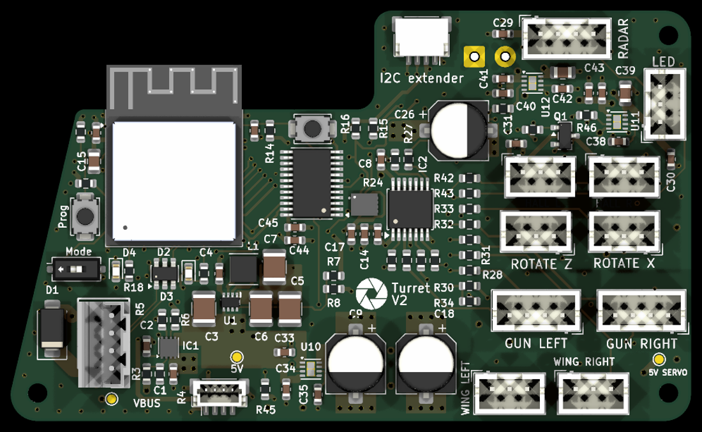
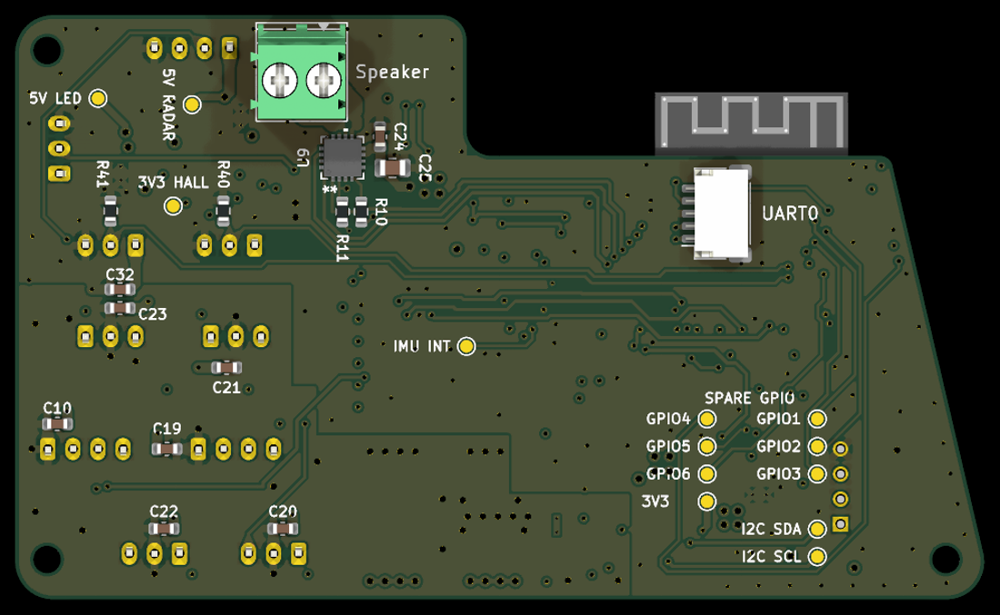
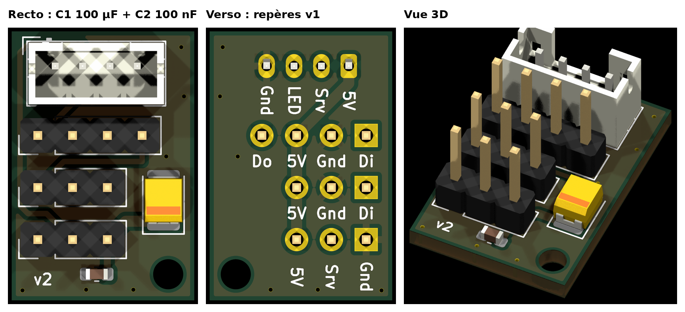
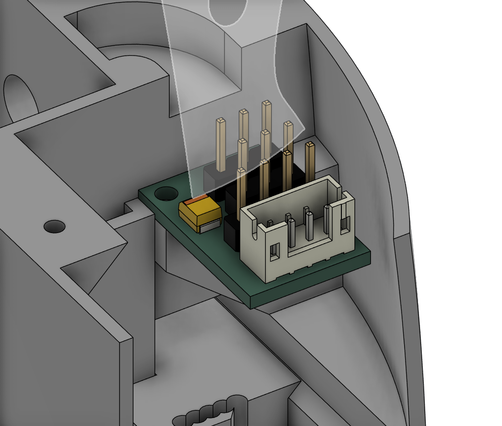

# Carte Turret2 v2 — état de la carte routée

> **Statut au 01.11.2026 : carte routée en 6 couches, DRC propre, pas encore commandée ni fabriquée.**
>
> Ce document décrit la carte **telle qu'elle est dans KiCad**. Les valeurs viennent du projet lui-même (`kicad-cli`, scripts pcbnew) le 01.11.2026. Le pourquoi des choix reste dans [carte-v2-plan.md](carte-v2-plan.md), et la méthode dans [carte-v2-kicad.md](carte-v2-kicad.md). **Là où le plan et ce document diffèrent, ce document fait foi** (liste des écarts au §9).
>
> Projet maître, **hors dépôt** : `Desktop\Turret2_v2_6c\Turret2.kicad_pro` (KiCad 10.0). Le projet à 4 couches `Desktop\Turret2_v2\` a le même schéma, mais seule la version à 6 couches est routée. Carte fille des canons v2 : `Desktop\Turret2_carte_fille\` (§10).





---

## 1. Résumé

| Point | Valeur |
|---|---|
| Contour | 77,3 × 46,6 mm, partie droite rehaussée de 6 mm ; trous M2 H1, H2 (v0.1) et H3 en (139,065 ; 83,175) |
| Couches | **6**, 1,6 mm (§2) |
| Empreintes | 132 : 103 au recto, 29 au verso |
| Pistes | 968 segments : recto 818 mm, verso 669 mm, In3 568 mm |
| Vias | 315 : 238 × 0,6 / 0,3 ; 68 × 0,9 / 0,5 (puissance) ; 4 × 0,5 / 0,2 et 4 × 0,45 / 0,2 (pas fin) ; 1 × 0,5 / 0,25 (VBUS de D2) |
| Nets | 104 |
| DRC (zones remplies à nouveau) | **0 erreur, 0 élément non connecté** ; avertissements : 2 × contour de U7 qui dépasse du bord (antenne en porte-à-faux, voulu), 2 × `lib_footprint_mismatch` (logo, J15), 1 × hauteur du texte « 5V SERVO » de TP2 |
| ERC | 0 erreur ; 1 avertissement : broche 17 (pad exposé, type « non spécifié ») de U9 reliée à un symbole GND |
| Logo | « Turret V2 », au recto |

---

## 2. Empilement et règles

### 2.1 Empilement (JLC06161H-2116, ordre standard de JLC)

| Couche | Nom KiCad | Rôle | Épaisseur du diélectrique en dessous |
|---|---|---|---|
| F.Cu | F.Cu | signaux, rapides permis ; zones locales (5V_etoile, 3V3, EPAD de U7…) | préimprégné 0,1164 mm, εr 4,16 |
| In1 | GND | **GND plein**, référence du recto ; aucune piste (règle DRC) | âme 0,55 mm |
| In2 | PWR | zones d'alimentation : 5V_logique, 5V_servos, 3V3, VBUS, GND_L3 ; aucune piste (règle DRC) | préimprégné 0,1164 mm |
| In3 | SIG | signaux **lents seulement** (sa référence est In2, découpée) ; interdit à l'USB, l'I²S, les données LED, l'audio et LX | âme 0,55 mm |
| In4 | GND2 | **GND plein**, référence du verso ; aucune piste (règle DRC) | préimprégné 0,1164 mm |
| B.Cu | B.Cu | signaux, rapides permis, capteurs Hall ; zones GND_L4 et 5V_servos_L4 | — |

Cuivre : 35 µm dehors, 15,2 µm dedans (valeurs de l'empilement KiCad). **À confirmer sur le calculateur d'impédance de JLC avant la commande.**

**Règle de routage propre au 6 couches** : une via GND à moins de 1,5 mm de chaque via d'un signal rapide (I²S, NeoPixel, USB), pour que le courant de retour passe d'In1 à In4.

### 2.2 Classes de nets

| Classe | Largeur | Isolement | Via |
|---|---|---|---|
| Power5V | 0,8 mm | 0,25 mm | 0,9 / 0,5 |
| Audio | 0,8 mm (règle : 1,5 visé) | 0,3 mm | 0,9 / 0,5 |
| Power3V3, GND | 0,5 mm | 0,2 mm | 0,6 / 0,3 |
| Buck_LX | 0,8 mm | 0,2 mm | 0,6 / 0,3 |
| Servo, LEDData, I2C, I2S | 0,25 mm | 0,2 mm | 0,6 / 0,3 |
| Analog (Hall) | 0,2 mm | 0,25 mm (règle : 0,5 mm) | 0,6 / 0,3 |
| **USB** | **0,18 mm, écart 0,17 mm** | 0,2 mm | 0,6 / 0,3 |

**Règles DRC personnalisées** (`Turret2.kicad_dru`) : largeurs 5V, 5V servos, audio, GND, 3V3, servos et LED, Hall ; « Via puissance » (0,9 / 0,5) ; isolements audio et Hall ; In1, In2 et In4 sans piste ; In3 « signaux lents seulement » ; paire USB ; « Pas fin » (largeur et isolement de 0,2 mm sur les pastilles fines, **sauf la classe USB**) ; « D2 : via VBUS de référence » (via de 0,45 / 0,25 dans la zone de D2) ; un seul rayon thermique accepté pour les Hall sur In2 et les servos au verso ; broches GND de U9 en plein.

### 2.3 USB à 90 Ω différentiel

Calculé le 01.11.2026 avec un solveur par différences finies (extrapolation de Richardson), sur l'empilement du §2.1 :

| Tronçon | Largeur / écart | Impédance |
|---|---|---|
| `USB_D±` (D2 → module) | 0,18 / 0,17 mm | 90,0 Ω |
| `in_USB_D±` (J1 → D2) | 0,19 / 0,20 mm | 90,0 Ω |

L'ESP32-S3 est en Full Speed (12 Mbit/s) et la liaison est courte : l'impédance n'est pas critique, mais elle ne coûte rien ici. La largeur de la classe USB est passée à 0,18 / 0,17 dans le `.kicad_pro`.

---

## 3. Alimentation telle que câblée

```
J1 (USB déporté, TE AMP CT 292132-4) ── D1 SMAJ5.0A, D2 USBLC6-2SC6, C1 100 nF
   └─ VBUS ─► IC1 TPS259533 (R3 1 MΩ / R4 249 kΩ : OVLO ; R5 523 Ω : ILM ≈ 3,9 A ; C2 47 nF : dVdt ; PWR_FLT → IO21, R6)
        └─ +5V (zone 5V_etoile au recto, 5V_logique en In2)
             ├─ U10 TPS22965 SW_SERVO, CT 4,7 nF (C35), CIN C33 ─► 5V_SERVO ─► C9, C18 220 µF + C10, C19–C23 ─► J3, J4, J7–J10
             ├─ U11 TPS22965 SW_LED, CT 1 nF (C38), CIN C36 ─► 5V_LED ─► C39 10 µF, C30 ─► J14
             ├─ U12 TPS22965 SW_RADAR, CT 1 nF (C42), CIN C40 ─► 5V_RADAR ─► C43 10 µF, C29 ─► J5
             ├─ U9 MAX98357A (verso) : C24, C25 10 µF, C26 100 µF
             ├─ IC2 SN74AHCT125
             └─ U1 TPS631000 (L1 1 µH ; R7 511 kΩ / R8 91 kΩ) ─► +3V3 ─► Q1 AO3401A (HALL_EN_N) ─► 3V3_HALL ─► J17, J18
```

- **Commandes des rails** : U13 TCAL6416 (au **recto**), P00 `SERVO_EN`, P01 `LED_EN`, P02 `RADAR_EN`, P03 `HALL_EN_N`. Tirages R45–R47 (100 kΩ → GND) sur les EN, R48 (100 kΩ → +3V3) sur la grille de Q1. RESET de U13 relié à `S3En`, ADDR au GND (adresse **0x20**), INT non relié, P04–P17 libres.
- **Zones** : 5V_SERVO en In2 (5V_servos) et au verso (5V_servos_L4, d'un seul tenant) ; GND plein en In1 et In4, et au verso (GND_L4) ; au recto, des zones locales autour de l'étoile, de la sortie de SW_SERVO, du 3V3 et des bulks.
- **Mesure du courant et de la tension (plan §2.1) : non implantée.** ILM ne va qu'à R5 ; IO4 et IO5 sont libres, sur des points de test.
- **Pas de résistance de 0 Ω en 2512** pour la mesure du courant de veille (plan §8) : VBUS va directement de J1 à IC1.

---

## 4. Brochage de l'ESP32-S3 (U7) tel que câblé

Le brochage a changé au routage (« lot C » : ordre des GPIO revu pour supprimer les croisements). **Il remplace le tableau du §5 du plan.** Le firmware v2 doit suivre celui-ci.

| GPIO | Fonction v2 | Composants | Remarque |
|---|---|---|---|
| IO0 | PROG (SW2) | R21 10 kΩ → +3V3 | strap |
| IO1–IO6 | **libres** | TP10 (IO1), TP5–TP9 (IO2–IO6), au verso | ADC1, tactiles, RTC ; IO3 est un strap. **IO2 : bouton déporté J20, décidé le 02.11.2026, pas encore dans KiCad (§11)** |
| IO7 | SW1 « DEBUG » (`DEBUG_SW`) | R9 10 kΩ → +3V3 | SW1 fermé = 330 µA |
| IO8 | HALL_LEFT | R40 100 kΩ → GND | ADC1 |
| IO9 | HALL_RIGHT | R41 100 kΩ → GND | ADC1 |
| IO10 | RADAR_TX (ESP32 → radar) | R42 1 kΩ série | |
| IO11 | RADAR_RX (radar → ESP32) | R43 1 kΩ série | |
| IO12 | NEOPIXEL_CENTER (anneau) | R24 100 kΩ → GND ; IC2 3Y → R27 330 Ω → J14 | |
| IO13 | LED verte (`ESP32Debug`) | R18 100 Ω, D4 | v0.1 : IO33 |
| IO14 | IMU_INT1 | TP16 | RTC : réveil EXT1 |
| IO15 | ROTATE_X | R33 330 Ω → J10 | |
| IO16 | ROTATE_Z | R32 330 Ω → J9 | |
| IO17 | NEOPIXEL_LEFT | R22 100 kΩ → GND ; IC2 1Y → R25 330 Ω → J3 | |
| IO18 | NEOPIXEL_RIGHT | R23 100 kΩ → GND ; IC2 2Y → R26 330 Ω → J4 | |
| IO19 / IO20 | USB D− / D+ | D2 | |
| IO21 | PWR_FLT (eFuse) | R6 10 kΩ → +3V3 | entrée |
| IO26 | WING_LEFT | R30 330 Ω → J7 ; **R34 10 kΩ → GND** | pull-up interne au reset : le 10 kΩ garde la ligne basse |
| IO47 | LED rouge (`FaultLed`) | R12 680 Ω, D3 | v0.1 : IO48 (IO47 y était un gain de l'ampli) |
| IO33 | GUN_LEFT | R28 330 Ω → J3 | |
| IO34 | WING_RIGHT | R31 330 Ω → J8 | |
| IO48 | GUN_RIGHT | R29 330 Ω → J4 | |
| IO35 | SDA | R16 2,2 kΩ → +3V3 | **comme la v0.1** : `Wire.begin(35, 36)` |
| IO36 | SCL | R15 2,2 kΩ → +3V3 | |
| IO37 | I²S LRCLK | | |
| IO38 | I²S BCLK | | |
| IO39 | I²S DIN | | |
| IO40 | AMP_GAIN | | **jamais à l'état haut** (drain ouvert) |
| IO41 | AMP_GAIN_100K | R11 100 kΩ | **jamais à l'état haut** (drain ouvert) |
| IO42 | AMP_SD | R10 2 kΩ série | ampli coupé (IO42 bas) avant tout `i2s.end()` |
| IO43 / IO44 | UART0 TXD0 / RXD0 | J16 | |
| IO45 / IO46 | non connectées | | straps |
| EN | `S3En` | R14 10 kΩ, C13 1 µF ; RESET de U13 ; SW3 ; J16 | |

**Règles de sécurité à reporter dans le firmware v2** (elles diffèrent de la v0.1) : « jamais à l'état haut » porte sur **IO40 et IO41** (v0.1 : IO21 et IO47) ; « ampli coupé avant `i2s.end()` » porte sur **IO42** (v0.1 : IO13) ; l'I²C reste sur IO35 / IO36. **Ne pas flasher le firmware v0.1 sur une carte v2** : il pilote des PWM sur IO1–IO7, et IO7 est relié à SW1 (une sortie haute avec SW1 fermé, c'est un court-circuit vers GND). Le garde-fou de carte du plan (§10.3, extendeur à 0x20) reste valable : la v0.1 n'a rien à cette adresse.

---

## 5. Connecteurs

| Réf. | Rôle | Broches | Face |
|---|---|---|---|
| J1 | entrée USB déportée, **TE AMP CT 292132-4** | 1 VBUS · 2 D+ (`in_USB_D+`) · 3 D− · 4 GND | recto |
| J3 | GUN LEFT | 1 5V_SERVO · 2 PWM (IO33) · 3 données LED (IC2 1Y) · 4 GND | recto |
| J4 | GUN RIGHT | 1 5V_SERVO · 2 PWM (IO48) · 3 données LED (IC2 2Y) · 4 GND | recto |
| J5 | RADAR | 1 5V_RADAR · 2 RADAR_TX_C (IO10) · 3 RADAR_RX_C (IO11) · 4 GND | recto |
| J7 / J8 | WING LEFT / RIGHT | 1 GND · 2 5V_SERVO · 3 PWM (IO26 / IO34) | recto |
| J9 / J10 | ROTATE Z / X | 1 GND · 2 5V_SERVO · 3 PWM (IO16 / IO15) | recto |
| J14 | anneau LED | 1 5V_LED · 2 données (IC2 3Y) · 3 GND | recto |
| J17 / J18 | HALL L / R | 1 3V3_HALL · 2 HALL_LEFT / RIGHT · 3 GND | recto |
| J11 | Qwiic coudé | 1 GND · 2 +3V3 · 3 SDA · 4 SCL | recto |
| J19 | Qwiic vertical (Adafruit 4328) | idem J11 | recto |
| J15 | haut-parleur (bornier 3,5 mm) | OUTP · OUTN (BTL) | **verso** |
| J16 | UART0 (JST-SH 5) | 1 TXD0 · 2 RXD0 · 3 GND · 4 EN · 5 IO0 | **verso** |

Les J3 / J4 ont toujours une seule broche +5 V (5V_SERVO) partagée par le servo et les 2 LEDs du canon. Brochage J5 → RD-03D : voir le README (câble croisé).

**Points de test** : TP1 VBUS, TP2 5V_SERVO, TP3 +5V (recto) ; TP4 +3V3, TP5–TP10 IO1–IO6, TP11 5V_LED, TP12 5V_RADAR, TP13 3V3_HALL, TP14 SDA, TP15 SCL, TP16 IMU_INT1 (verso).

---

## 6. Implantation

- **Verso (29 empreintes)** : U9 (ampli) avec C24, C25, R10, R11 ; J15 ; J16 ; les 100 nF des connecteurs de servos (C10, C19–C23), C32 ; R40, R41 (tirages Hall) ; TP4–TP16.
- **Recto** : tout le reste, y compris **U6 (IMU) et U13 (extendeur)**, que le plan mettait au verso, et les trois switches. Conséquence pour le firmware : l'IMU n'est **pas retournée**, pas de matrice d'axes à prévoir pour le montage (plan §4.5, §10.6).
- **EPAD de U7** : 4 vias, comme sur la v1.
- **Pochoirs** : disques de pâte de Ø 2,2 mm sur **H1, H2 et H3**, sur F.Paste **et** B.Paste (ajoutés le 01.11.2026 ; la v0.1 n'en avait que sur H1 / H2, au recto) : les deux pochoirs s'ouvrent au droit des trois trous, pour les centrer et les tenir sur trois goupilles. Vérifié dans les Gerber de pâte.
- **Sérigraphie** : style de la v1. Étiquettes de connecteurs en 1,0 mm (paires WING / HALL en 0,8 mm), points de test et références en 0,8 mm, trait de 0,15 mm. Références des connecteurs, des points de test et des interrupteurs masquées. 15 références de passifs masquées faute de place (gardées en F.Fab). SW2 marqué « Prog ». Logo « Turret V2 » réduit, au recto.
- **Fusion** : le modèle 3D de la carte (export STEP du 01.11.2026, `3D\Turret2_v2_6c_01-11.step`) remplace l'ancienne « Turret2 rehausse » dans le design de la tourelle, à la même position. Les modèles 3D de U10–U12 (WSON-8 de TI) manquent dans la bibliothèque 3D de KiCad.

---

## 7. Historique du routage 6 couches (30.10 – 01.11.2026)

Plan de routage local : `Desktop\Turret2_v2_6c\PLAN_ROUTAGE_6C.html` (ordre : bloc d'alimentation, vias de sortie du module, nappes au verso et en In3, connecteurs, I²C, EN, alimentations, GND, finitions).

| Date | Travail | Résultat |
|---|---|---|
| 30.10 | Copie 6 couches avec les lots A, B, C et R34 ; empilement JLC06161H-2116 ; règles In1 / In2 / In4 sans piste, In3 lents seulement | DRC 0 erreur, 162 liaisons à router |
| 31.10 | 5V_LED, 5V_RADAR, 3V3 de droite (In3), commandes EN ; GND de l'IMU (via au centre) ; coupure de la zone 5V_etoile réparée | toutes les liaisons faites |
| 01.11 | EPAD de U7 à 4 vias comme la v1 ; USB à 90 Ω (§2.3) | |
| 01.11 | Contrôle des isthmes de zone, vias de couture, vias GND à côté des vias rapides | |
| 01.11 | Analyse des pistes et corrections : LX1 élargi à 0,5 mm (0,6 mm touchait C4) ; LX2 laissé tel quel (trop près de L1.1) ; pistes rendues plus propres autour de LX1 / LX2 | |
| 01.11 | Sérigraphie harmonisée sur la v1 ; dessin de J15 écarté du bord (+0,6 mm) | |
| 01.11 | Export STEP, carte remplacée dans Fusion | |

**Restes connus, jugés acceptables** :

- la via de `NEOPIXEL_RIGHT_C` en (113,75 ; 109,28) a sa via GND la plus proche à 2,7 mm (pas de place plus près) ;
- 26 segments hors des angles de 45° ;
- 4 micro-segments gardés : les souder réduisait l'isolement (BCLK / DIN, IO2) ;
- des pistes IO1–IO6 passent sous le module : signaux lents, sur des points de test, sans effet.

---

## 8. Avant de commander

- [ ] **Remplir les zones (touche B) puis enregistrer.** Le fichier enregistré le 01.11.2026 à 13 h 41 contenait une via 5V_SERVO en (136,25 ; 121,5) plus récente que le remplissage : sans nouveau remplissage, elle touche les plans GND In1 et In4 (le DRC le signale). Après remplissage, c'est propre.
- [ ] Si les zones n'apparaissent pas à l'écran : réactiver « Afficher les zones remplies » (barre de gauche). Une pastille qui semble isolée sans ligne de chevelu est en fait reliée par une zone (cas de J16, vérifié le 01.11.2026).
- [ ] Empilement et impédance confirmés sur le calculateur de JLC (JLC06161H-2116).
- [ ] Texte « 5V SERVO » de TP2 : remonter sa hauteur au minimum du fabricant.
- [ ] Gerber, perçages, nomenclature, positions ; **deux pochoirs** (recto et verso), avec à la commande la mention « garder les 3 ouvertures hors pastilles (trous de centrage) ».
- [ ] Vérification du schéma ↔ PCB (`kicad-cli pcb drc --schematic-parity`).
- [ ] **Bouton déporté J20 sur IO2** (§11) : ajouter au schéma et au PCB, puis refaire DRC, remplissage des zones et export STEP.
- [ ] Revue finale de la netlist contre ce document.

---

## 9. Écarts entre le plan et la carte

| Plan ([carte-v2-plan.md](carte-v2-plan.md)) | Carte routée | Remarque |
|---|---|---|
| 4 couches | **6 couches** (§2) | GND plein des deux côtés ; In3 pour les signaux lents |
| Brochage du §5 (IO1 ROTATE_X, IO11 / IO12 I²C, IO37 AMP_SD…), puis « brochage final » du §5.3 (28.10.2026 : IO26 PWR_FLT, IO21 WING_RIGHT, IO9 RADAR_TX, IO12 ROTATE_X, R34 retirée…) | **brochage du §4 de ce document** | lot C du routage (30.10.2026) ; I²C sur IO35 / IO36 comme au §5.3 ; R34 remise (IO26 = WING_LEFT) |
| Mesure du courant (ILM → IO4) et de la tension (+5V → IO5) (§2.1) | **non implantée** | IO4 et IO5 libres, sur TP7 / TP8 |
| 0 Ω 2512 après D1 (§8) | absente | |
| D1 en SMAJ6.5A (§7) | **SMAJ5.0A** gardée | à revoir après la mesure de fuite sur la v0.1 (§11 du plan) |
| J1 en JST-XH B4B-XH-A (§2) | **TE AMP CT 292132-4** | même brochage |
| IMU et extendeur au verso (§0, §8) | **au recto** | pas de matrice d'axes pour l'IMU |
| Option 100 kΩ → GND sur les PWM (§4.8) | seulement **R34 10 kΩ** sur IO26 (obligatoire) | |
| USB 0,2 / 0,15 mm | **0,18 / 0,17 mm** et 0,19 / 0,20 mm (§2.3) | 90 Ω |
| Sérigraphie « v0.2 » (§8) | logo « Turret V2 » | |
| Pull-down de IO26 (10 kΩ) sur GUN_RIGHT | IO26 = **WING_LEFT**, avec R34 | même rôle |

---

## 10. Carte fille des canons v2

Projet `Desktop\Turret2_carte_fille\` (KiCad 10, 2 couches), créé le 01.11.2026 à partir des Gerber de la v1 (`Fork/gerber/DaughterBoard.zip`). **ERC 0, DRC 0, parité schéma ↔ PCB 0.**



- **Identique à la v1** : contour de 13,335 × 19,685 mm ; J1 (JST-PH 4), J5 (1 × 4), J4 et J2 (1 × 3) aux mêmes coordonnées ; trou M2 au même endroit ; même cheminement des signaux au recto ; repères au verso.
- **Brochage de J2 gardé** (Gnd · Srv · 5V), pour rester compatible avec les câbles existants. Une prise de servo standard met le +5 V au milieu : vérifier le sens sur les canons.
- **Ajouts** :
  - **C1, 100 µF 10 V tantale polymère**, KEMET **T520B107M010ATE070** (boîtier B 3528, 1,9 mm de haut, 70 mΩ), au recto, dans le coin libre à droite de J4 / J2, relié au 5V de J2 par une piste de 0,8 mm. Mouser 80-T520B107M10ATE070 ou LCSC C600583. **Pas** le T520B107M004 (4 V).
  - **C2, 100 nF X7R 0603** (KEMET C0603C104K5R, 50 V), au recto juste sous J2.
  - Plan de masse sur les deux faces ; 5V de 0,8 mm au verso.
- **Pas de résistance série** sur la carte fille : les 330 Ω du PWM (R28, R29) et des données LED (R25, R26) sont déjà sur la carte principale v2.
- **Place dans le canon (vérifiée dans Fusion le 01.11.2026)** : la carte se pose à plat sur le rebord du `GunCasing`, sous l'arche des fils, connecteurs vers le haut, côté trou en appui et côté JST en porte-à-faux vers l'avant. Le rebord a **deux avant-trous de Ø 1,8 mm écartés de 9,52 mm**, l'écart entre les deux coins du petit côté de la carte : un pour le canon gauche, un pour le canon droit (en miroir). Calcul d'intersection avec le boîtier : le circuit, C1, C2, le JST, J5 et J4 ne touchent rien ; C1 est à environ 10 mm sous le couvercle. **Seules les queues des broches de J2** (1,4 mm sous la carte) entrent de 0,1 à 0,8 mm dans le bord du rebord, comme sur la v1 : **les couper à ras** (ou souder les fils du servo directement). La carte est placée dans le design Fusion sous `GunCasing` (« Carte fille canon v2 ») ; STEP : `Turret2_carte_fille\3D\Turret2_carte_fille_trou_origine.step` (origine sur le trou M2).



- **Fabrication** : JLCPCB facture un ébavurage (0,02 $ par carte quand un côté fait entre 1,5 et 3 cm) ; normal pour une carte de cette taille.

---

## 11. Modification décidée le 02.11.2026 : bouton déporté J20 sur IO2 (à faire dans KiCad)

**Pourquoi** : sans boutons A / B, PROG (SW2) est le seul bouton de la v2 en dehors du knob de debug. Il sert au Wi-Fi (maintenu 3 s), au réveil de la veille profonde et, avec SW1, à la remise à zéro. S'il n'est pas accessible tourelle fermée, un bouton déporté sur la coque le remplace. IO2 est libre, c'est une broche RTC (réveil possible), et elle est déjà sur TP5.

**Bouton actif à l'état haut**, pas vers la masse : en veille profonde, l'ESP32-S3 n'a que deux réveils par niveau. EXT0 (une broche) est pris par PROG (IO0, actif bas). EXT1 (un groupe de broches) n'a qu'un mode commun, ici « l'une est haute », celui de l'IMU (INT1, IO14). Un bouton vers +3V3 rejoint ce groupe ; un bouton vers la masse ne pourrait pas.

| Réf. | Valeur | Raccordement | Rôle |
|---|---|---|---|
| J20 | connecteur 2 broches (par exemple JST-PH, B2B-PH-K-S), au bord de la carte | 1 = BTN_3V3, 2 = BTN | vers le bouton (contact simple, normalement ouvert) |
| R50 | 1 kΩ 0603 | +3V3 → J20.1 | limite à 3,3 mA un court-circuit de BTN_3V3 vers la masse (câble abîmé) ; ESD |
| R51 | 1 kΩ 0603 | J20.2 → IO2 | protection de la GPIO, ESD ; même rôle que les 1 kΩ du radar |
| R49 | 100 kΩ 0603 | IO2 → GND, côté module | IO2 bas au repos, connecteur débranché compris ; 0 µA en veille tant qu'on n'appuie pas |
| C46 | 10 nF X7R 0603 (facultatif) | IO2 → GND, côté module | ESD et rebonds (τ = 10 µs avec R51) |

- Appuyé : IO2 = 3,3 V × 100 / 102 ≈ **3,24 V** (1,6 mA). Relâché : 0 V.
- Références à confirmer à l'annotation : R49–R51 et J20 sont libres d'après ces documents ; C44 / C45 sont déjà le découplage de l'extendeur, d'où C46.
- Routage : signal lent, In3 permis ; garder TP5 sur IO2.

**Firmware** (fait le 02.11.2026, `PIN_BUTTON_EXT` = 2 dans `pins.h`) : maintenu 3 s = Wi-Fi marche / arrêt (comme PROG) ; tout appui réveille la veille radar ; réveil de la veille profonde par EXT1 avec l'IMU ; commande `inputs` (état du bouton). Sans J20 câblé, rien ne change (IO2 tiré bas).

---

## Sources

- Projet KiCad `Desktop\Turret2_v2_6c\` : `Turret2.kicad_pcb`, `Turret2.kicad_sch`, `mcu.kicad_sch`, `rails.kicad_sch`, `Turret2.kicad_dru`, relevés le 01.11.2026 (`kicad-cli` 10.0, scripts pcbnew).
- `Desktop\Turret2_v2_6c\PLAN_ROUTAGE_6C.html` (plan de routage 6 couches, local).
- Projet `Desktop\Turret2_carte_fille\` ; Gerber de la v1 : `Fork/gerber/DaughterBoard.zip`.
- KEMET T520B107M010ATE070 : [Mouser](https://www.mouser.ch/fr/ProductDetail/KEMET/T520B107M010ATE070?qs=Ad%252Bh9aq9FyXTYAzVu0V6qA%3D%3D), [LCSC C600583](https://www.lcsc.com/product-image/C600583.html).
- JLCPCB, [In what cases will there be charged extra?](https://jlcpcb.com/help/article/in-what-cases-will-there-be-charged-extra)
