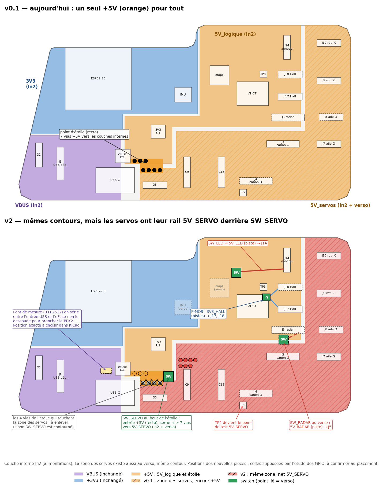

# Carte Turret2 v2 — guide pas à pas dans KiCad

> **Rôle** : faire la carte v2 dans KiCad, étape par étape. Le **quoi** et le **pourquoi** sont dans [carte-v2-plan.md](carte-v2-plan.md) (les « §… » renvoient à ce plan) ; ici, le **comment** et **dans quel ordre**.
>
> Rédigé le 22.10.2026 pour **KiCad 10.0** (10.0.6 installé), à partir du projet v0.1 du dépôt (`Turret2_portable/`). Les références de composants, les noms de nets et les numéros de broches cités ici sont relevés dans ce projet (netlist exportée avec `kicad-cli` le 22.10.2026).

---

## Comment s'en servir

- **Une étape à la fois, dans l'ordre.** Chaque phase finit par un **point de contrôle** : enregistrer, lancer l'ERC (ou le DRC), faire un commit (`v2 : étape N — …`), puis me dire « étape N faite ».
- **À chaque point de contrôle, je vérifie sans ouvrir KiCad** : `kicad-cli` exporte la netlist et lance l'ERC / le DRC ; je compare au plan et je te dis ce qui manque ou ce qui est faux. On ne passe à la suite que quand c'est propre.
- **Utiliser les noms de nets de ce guide** (5V_SERVO, SERVO_EN, etc.) : mes vérifications s'appuient dessus.
- **Ce que je peux faire pour toi** : préparer le symbole du TPS22965 (étape 2.0), vérifier chaque point de contrôle, relancer l'étude des GPIO sur ton placement (étape 5.5), tenir le plan et le journal à jour.

| Phase | Où | Contenu | Taille |
|---|---|---|---|
| 0 | dépôt, KiCad | copie de travail v2, état de départ | petite |
| 1 | schéma | retraits, valeurs, résistances simples, second port I²C | moyenne |
| 2 | schéma | nouvelle feuille « Rails » : 3 switches, P-MOS, extendeur ; rails branchés | grosse |
| 3 | schéma | nouveau brochage de l'ESP32 | moyenne, **délicate** |
| 4 | schéma | finitions : points de test, annotation, empreintes, nomenclature | moyenne |
| 5 | PCB | carte agrandie à droite, mise à jour, placement, étude des GPIO | grosse |
| 6 | PCB | routage, DRC, sérigraphie | grosse |
| 7 | fabrication | fichiers, contrôle final | moyenne |

**Pourquoi cet ordre** : tout le schéma d'abord, pour ne mettre le PCB à jour qu'une fois ; dans le schéma, les changements faciles en premier ; les nouveaux circuits **avant** le rebrochage de l'ESP32, pour que tous les nets existent quand on pose les labels ; sur le PCB, placer, vérifier l'étude des GPIO, **puis** router.

---

## Phase 0 — Préparer

### 0.1 Choisir où vit la v2 (décision)

**Recommandé : un dossier `Turret2_v2/` dans le dépôt**, copie de `Turret2_portable/` :

- versionné : une étape = un commit, retour en arrière facile ;
- autonome (librairies `Turret_*` dans `library/`) : je peux vérifier chaque étape ;
- la v0.1 reste intacte dans `Turret2_portable/`, pour les cartes actuelles.

**Avant la copie** : rafraîchir `Turret2_portable/` depuis le projet maître (son PCB porte encore R18 = 1 kΩ), puis marquer la v0.1 dans git (`git tag hw-v0.1`).

**Sur le PC du projet maître** (choix du 22.10.2026) : cloner le dépôt sur ce PC et créer `Turret2_v2/` **à partir du projet maître** (pas de la copie portable, qui peut être en retard). Si le projet maître utilise des librairies globales, copier celles qui servent dans `library/`, comme pour la copie portable, pour que le dossier soit autonome. Pousser à chaque point de contrôle : je récupère les fichiers sur GitHub pour les vérifier. Une session Claude sur ce PC peut aussi le faire, si KiCad 10 y est installé (`kicad-cli`).

*Autre possibilité* : travailler dans le projet maître, hors dépôt, et recopier à chaque point de contrôle. Plus lourd, et je ne vois que les copies.

### 0.2 Créer la copie

- Copier le dossier dans l'Explorateur → `Turret2_v2/`, **sans** `Turret2-backups/`. Garder les noms de fichiers (`Turret2.kicad_pro`, `mcu.kicad_sch`…) : les différences restent lisibles dans git.
- Ne pas versionner les sauvegardes automatiques de KiCad pour la v2 (`Turret2_v2/Turret2-backups/` dans `.gitignore`) : un zip par sauvegarde alourdit vite le dépôt.
- Ouvrir `Turret2_v2/Turret2.kicad_pro` dans KiCad 10 ; vérifier qu'aucune librairie ne manque.

### 0.3 État de départ

- **ERC** (Inspecter > Contrôle des règles électriques) : la v0.1 donne **28 avertissements, aucun bloquant** :
  - 18 « librairie de symboles '' absente » : symboles importés de LCSC, intégrés au schéma ;
  - 5 « symbole différent de la copie en librairie » (SMAJ5.0A × 2, MAX98357A, TC2050-IDC, ESP32-S3-MINI-1) ;
  - 4 « broche non connectée reliée » sur IO39–IO42 : croix au bout des fils JTAG, supprimées à l'étape 3 ;
  - 1 pad de l'ampli (type « non spécifié ») relié à GND.

  À chaque point de contrôle, seuls les **nouveaux** avertissements comptent.
- **Cartouche** de chaque feuille (Fichier > Paramètres de la page) : révision « v0.2 », date.

**Point de contrôle 0** : commit « v2 : étape 0 — copie de la v0.1 ».

---

## Phase 1 — Schéma : retraits, valeurs, résistances simples

Le schéma a trois feuilles : **racine** (`Turret2.kicad_sch` : USB-C, TVS, eFuse, TPS631000), **MCU** (`mcu.kicad_sch` : ESP32, IMU, ampli, AHCT, LEDs, connecteurs des servos) et **IO** (`untitled.kicad_sch` : les autres connecteurs).

### 1.1 Retirer

| Feuille | À supprimer | Remarque |
|---|---|---|
| MCU | R13, R17 (1 kΩ série), R19, R20 (pull-ups), C11, C12 (100 nF), et leurs fils jusqu'à IO26 / IO34 | les broches restent libres, reprises à l'étape 3 |
| IO | J12, J13 (boutons A et B) | |
| MCU | J2 (TC2050-IDC) | relié à rien dans la netlist et absent du PCB ; à garder seulement si tu comptes t'en servir |
| racine | USBC1 (USB-C), R1, R2 (5,1 kΩ du CC), D5 (seconde TVS) | décision du 23.10.2026 : seule entrée, J1 (plan §2) ; D1 (TVS) et D2 (USBLC6) restent |

**J1 change d'empreinte** (JST-PH → JST-XH 4 broches, étape 4.3) : même symbole, même brochage (1 VBUS, 2 D+, 3 D−, 4 GND).

Les labels JTAG_* et les croix au bout des fils de IO39–IO42 partent à l'étape 3 : les fils resteront pour l'I²S.

### 1.2 Changer des valeurs

| Réf. | v0.1 | v2 | Attention |
|---|---|---|---|
| IC1 | TPS259573DSGT | **TPS259533DSGR** | même symbole, même empreinte : changer la valeur et les champs fabricant / Mouser (§4.2) |
| R7 | 56 kΩ | **511 kΩ 1 %** | symbole importé de LCSC : changer aussi « Manufacturer Part » et « Supplier Part », sinon la nomenclature commande encore la 56 kΩ (§4.10) |
| R8 | 10 kΩ | **91 kΩ 1 %** | idem |
| D1, D5 | SMAJ5.0A | inchangées pour l'instant | SMAJ6.5A seulement après la mesure de fuite (§11) ; même empreinte |

### 1.3 Ajouter les résistances « simples »

Elles se branchent sur des nets dont le nom ne change pas : on peut les poser dès maintenant. Pour une résistance **en série**, couper le fil entre le label et la broche du connecteur et l'y insérer ; le label reste côté ESP32, et **le côté connecteur reçoit un label au même nom suffixé « _C »** (GUN_LEFT_C, RADAR_TX_C, NEOPIXEL_RING_C pour J14, NEOPIXEL_LEFT_C pour J3.3…) : il garde ainsi sa classe de net, donc sa largeur et ses isolements (étape 4.7). Sans nom, il tomberait dans la classe par défaut (0,2 mm).

| Ajout | Net | Où | Plan |
|---|---|---|---|
| 10 kΩ → +3V3 | S3PRG (IO0) | MCU, près de SW2 | §4.7 |
| 100 kΩ → GND × 2 | HALL_LEFT, HALL_RIGHT | IO, près de J17 / J18 | §4.8 |
| 100 kΩ → GND × 3 | NEOPIXEL_CENTER, NEOPIXEL_LEFT, NEOPIXEL_RIGHT | MCU, entrées 1A–3A de IC2 | §4.6 |
| 330 Ω série × 3 | sorties de IC2 : 1Y → J14.2, 2Y → J3.3, 3Y → J4.3 | MCU, à la sortie de IC2 | §4.6 |
| 330 Ω série × 6 | GUN_LEFT → J3.2, GUN_RIGHT → J4.2, WING_LEFT → J7.3, WING_RIGHT → J8.3, ROTATE_Z → J9.3, ROTATE_X → J10.3 | MCU, près des connecteurs | §4.8 |
| ~~10 kΩ → GND~~ | ~~GUN_RIGHT~~ : retirée le 28.10.2026 (R34), GUN_RIGHT n'est plus sur IO26 | MCU | §5 |
| *option* 100 kΩ → GND × 5 | ROTATE_X, ROTATE_Z, GUN_LEFT, WING_LEFT, WING_RIGHT | à côté des 330 Ω ; attribut DNP (« ne pas monter ») tant que la place n'est pas confirmée | §4.8 |
| 1 kΩ série × 2 | RADAR_TX → J5.2, RADAR_RX → J5.3 | IO, près de J5 | §4.8 |
| ~~0 Ω 2512 (≥ 4 A)~~ | **supprimée le 28.10.2026 (R44)** : VBUS va directement à l'entrée de IC1, plus de net `VBUS_IN` | — | §8 |

### 1.4 Second port I²C (J19)

Feuille IO, à côté de J11 : un connecteur 4 broches (même symbole que J11), **J19**, relié aux mêmes nets que J11 : 1 GND, 2 +3V3, 3 SDA, 4 SCL, pattes de fixation à GND (§6). Pièce : Adafruit 4328, Qwiic vertical.

**Point de contrôle 1** : ERC (rien de nouveau), commit. Je vérifie : pièces retirées absentes, valeurs, chaque nouvelle résistance sur les bons nets.

---

## Phase 2 — Schéma : nouvelle feuille « Rails »

### 2.0 Les symboles

| Pièce | Symbole | Empreinte |
|---|---|---|
| TPS22965 × 3 | **absent des librairies de KiCad 10** : je le prépare dans une librairie du projet (`library/symbols/Turret_v2.kicad_sym`), ou tu le dessines (ci-dessous) | celle de IC1 : `Turret_Package_SON:Texas_DSG0008A_WSON-8-1EP_2x2mm_P0.5mm_EP0.9x1.6mm_ThermalVias` (même boîtier TI « DSG » ; vérifier le pad central dans le dessin mécanique de la datasheet du TPS22965) |
| Extendeur | `Interface_Expansion:PCAL6416APW` (même brochage TSSOP-24 que le TCAL6416 [DS]) ; valeur = la pièce achetée (TCAL6416PWR ou PCAL6416APW) | `Package_SO:TSSOP-24_4.4x7.8mm_P0.65mm` |
| P-MOS | `Transistor_FET:AO3401A` | `Package_TO_SOT_SMD:SOT-23` |

Si tu dessines le TPS22965 : broches 1 et 2 VIN (entrée d'alimentation), 3 ON (entrée), 4 VBIAS (entrée d'alimentation), 5 GND (entrée d'alimentation), 6 CT (passive), 7 et 8 VOUT (**sortie d'alimentation** : l'ERC voit alors les rails comme alimentés), 9 = pad thermique (GND).

### 2.1 Créer la feuille

Sur la feuille racine : Placer > Feuille hiérarchique, nom « Rails », fichier `rails.kicad_sch`. Dedans :

- symboles d'alimentation existants : +5V, +3V3, GND ;
- **labels globaux** existants : SDA, SCL, S3En (EN de l'ESP32) ;
- **labels globaux nouveaux** : 5V_SERVO, 5V_LED, 5V_RADAR, 3V3_HALL ;
- **labels locaux** (internes à la feuille) : SERVO_EN, LED_EN, RADAR_EN, HALL_EN_N.

### 2.2 SW_SERVO (un circuit à la fois)

TPS22965 et autour (§4.1, valeurs §3.1) :

| Broche | Raccordement |
|---|---|
| VIN (1, 2) | +5V, **1 µF** au ras |
| VBIAS (4) | +5V, **100 nF** |
| ON (3) | SERVO_EN, **100 kΩ → GND** |
| CT (6) | **4,7 nF 25 V X7R** → GND |
| VOUT (7, 8) | 5V_SERVO |
| GND (5), pad | GND |

### 2.3 SW_LED et SW_RADAR

Copier-coller le bloc SW_SERVO deux fois, puis changer : **CT 1 nF** ; ON → LED_EN / RADAR_EN ; VOUT → 5V_LED / 5V_RADAR ; **10 µF** sur chaque sortie.

### 2.4 P-MOS des capteurs Hall (AO3401A)

Source → +3V3 ; drain → 3V3_HALL ; grille → HALL_EN_N, avec **100 kΩ grille → +3V3** (coupé par défaut, §4.3).

### 2.5 Extendeur

| Broche | Raccordement |
|---|---|
| 2 VDD_I2C, 24 VDD_P | +3V3, **100 nF** chacune, au ras |
| 12 VSS | GND |
| 22 SCL, 23 SDA | SCL, SDA (pull-ups existants R15 / R16, rien de plus) |
| 3 ~RESET | S3En |
| 21 ADDR | **GND en direct** (adresse 0x20 [DS]) |
| 1 ~INT | croix « non connecté », ou point de test |
| 4 P0_0 | SERVO_EN |
| 5 P0_1 | LED_EN |
| 6 P0_2 | RADAR_EN |
| 7 P0_3 | HALL_EN_N |
| 8–11, 13–20 | croix « non connecté » ; quelques points de test si tu veux |

Les pull-downs des ON (étapes 2.2, 2.3) et le pull-up de la grille (2.4) sont déjà posés.

### 2.6 Brancher les charges sur les rails

| Rail | Passent de +5V / +3V3 au rail | Feuille |
|---|---|---|
| 5V_SERVO | J3.1, J4.1, J7.2, J8.2, J9.2, J10.2 ; C9, C18 (220 µF) ; C10, C19, C20, C21, C22, C23 (100 nF des connecteurs) | MCU |
| 5V_LED | J14.1 ; C30 | IO |
| 5V_RADAR | J5.1 ; C29 | IO |
| 3V3_HALL | J17.1, J18.1 ; C31, C32 | IO |

**Restent sur +5V** : sortie de IC1, U1 (TPS631000), U9 (ampli) avec C24, C25, C26, IC2 (AHCT), C3, C4, C8, TP3. **TP2** passe sur 5V_SERVO : il est déjà dans la zone des servos sur le PCB (étape 5.4), il devient le point de test de ce rail.

Sur la feuille MCU, le +5V est dessiné à partir de **trois symboles +5V** et de fils : repérer la branche qui dessert les connecteurs de servos et leurs condensateurs, la séparer du reste (AHCT, ampli) et y mettre le label global 5V_SERVO.

**Point de contrôle 2** : ERC. Si l'ERC signale une entrée d'alimentation non alimentée sur un rail, poser un PWR_FLAG sur ce rail (ou vérifier que VOUT est bien une sortie d'alimentation dans le symbole). Commit. Je vérifie : la liste exacte de chaque rail, ce qui reste sur +5V, les broches de l'extendeur, les tirages.

---

## Phase 3 — Schéma : nouveau brochage de l'ESP32

**Délicat** : deux labels identiques sur deux broches relient deux fonctions entre elles, et l'ERC ne le voit pas toujours. D'où trois passes, et ma vérification par la netlist à la fin.

### 3.1 Effacer

Sur U7 (feuille MCU), effacer les labels de toutes les GPIO, **sauf** : IO0 (S3PRG), USB D– / D+, TXD0 / RXD0, EN (S3En), et les croix de IO45 / IO46. Garder les bouts de fil. Effacer aussi les labels JTAG_TCK / TDO / TDI / TMS et les **4 croix** au bout des fils de IO39–IO42.

### 3.2 Poser les labels v2

Mêmes noms qu'aujourd'hui (l'autre bout de chaque net ne bouge pas) ; type : **G** = label global, **L** = label local de la feuille MCU, comme sur la v0.1.

| Broche du module | GPIO | Label | Type | | Broche du module | GPIO | Label | Type |
|---|---|---|---|---|---|---|---|---|
| 5 | IO1 | libre (3.3) | — | | 25 | IO21 | WING_RIGHT | L |
| 6–10 | IO2–IO6 | libres (3.3) | — | | 26 | IO26 | PWR_FLT | G |
| 11 | IO7 | DEBUG_SW (SW1) | L | | | | | |
| 12 | IO8 | HALL_LEFT | G | | 27 | IO47 | FaultLed (LED rouge, R12) | L |
| 13 | IO9 | RADAR_TX | G | | 28 | IO33 | GUN_LEFT | L |
| 14 | IO10 | HALL_RIGHT | G | | 29 | IO34 | WING_LEFT | L |
| 15 | IO11 | RADAR_RX | G | | 30 | IO48 | GUN_RIGHT | L |
| 16 | IO12 | ROTATE_X | L | | 31 | IO35 | SDA | G |
| 17 | IO13 | ESP32Debug (LED verte, R18) | L | | 32 | IO36 | SCL | G |
| 18 | IO14 | NEOPIXEL_RIGHT | L | | 33 | IO37 | AMP_SD | L |
| 19 | IO15 | IMU_INT1 | L | | 34 | IO38 | AMP_GAIN | L |
| 20 | IO16 | NEOPIXEL_LEFT | L | | 35 | IO39 | DIN | L |
| 21 | IO17 | ROTATE_Z | L | | 36 | IO40 | AMP_GAIN_100K | L |
| 22 | IO18 | NEOPIXEL_CENTER | L | | 37 | IO41 | BCLK | L |
| | | | | | 38 | IO42 | LRCLK | L |

*Révisé le 28.10.2026* : tableau mis au brochage final (étude relancée sur le placement réel, plan §5.3). JTAG_SEL est renommé DEBUG_SW, aux deux bouts (SW1 et IO7) : SW1 ne sert plus au JTAG.

### 3.3 Broches libres IO1–IO6

Un point de test sur chacune (symbole et empreinte comme TP1–TP4 : `Turret_TestPoint:TestPoint_Pad_D1.0mm`), valeur « GPIO1 »…« GPIO6 » (TP10, TP5–TP9). IO2 : pastille de la future touche tactile de réveil.

**Point de contrôle 3** : ERC (les 4 croix de IO39–IO42 ont disparu), commit. Je vérifie par la netlist : chaque fonction sur **une seule** broche de U7, la bonne ; plus rien sur les anciennes broches ; aucune broche de U7 partagée entre deux nets.

---

## Phase 4 — Schéma : finitions

1. **Points de test** (§8) sur 5V_LED, 5V_RADAR, 3V3_HALL, SDA, SCL, IMU_INT1 ; celui de 5V_SERVO est TP2 (étape 2.6).
2. **Annoter** (menu Outils) en **conservant les annotations existantes** : seules les nouvelles pièces reçoivent un numéro, la v0.1 garde les siens.
3. **Empreintes** des nouvelles pièces (Outils > Assigner les empreintes) :

   | Pièce | Empreinte |
   |---|---|
   | TPS22965 × 3 | celle de IC1 (étape 2.0) |
   | Extendeur | `Package_SO:TSSOP-24_4.4x7.8mm_P0.65mm` |
   | AO3401A | `Package_TO_SOT_SMD:SOT-23` |
   | R et C 0603 | comme la v0.1 : `Turret_Resistor_SMD:R_0603_1608Metric`, `Turret_Capacitor_SMD:C_0603_1608Metric` |
   | 10 µF | `Turret_Capacitor_SMD:C_0805_2012Metric` (comme C15, C25) |
   | J19 (Qwiic vertical) | `Connector_JST:JST_SH_BM04B-SRSS-TB_1x04-1MP_P1.00mm_Vertical` |
   | J1 (USB déporté, JST-XH) | `Connector_JST:JST_XH_B4B-XH-A_1x04_P2.50mm_Vertical` |
   | Points de test | `Turret_TestPoint:TestPoint_Pad_D1.0mm` |

4. **Champs pour la nomenclature** : valeur et référence fabricant de chaque nouvelle pièce ; attribut DNP sur les pull-downs PWM optionnels si tu n'as pas tranché. Au passage, **des références de la v0.1 ne collent pas** :
   - **C27** : valeur 1 µF, mais référence fabricant CL05B104KO5NNNC, qui est un **100 nF** en 0402 : à trancher ;
   - R1, R2, R8, C14, C17 : références LCSC en **0402**, alors que leurs empreintes sont en **0603**.

   Sans importance si tu soudes d'après les valeurs ; à corriger si la nomenclature sert à commander.
5. **ERC final** : il ne doit rester que les avertissements de départ (étape 0.3), moins les 4 croix.
6. **Nomenclature** : je la compare à la liste d'achat (§3.1).
7. **Classes de nets** (Paramètres du schéma ou de la carte > Classes de nets, partagés par le projet). Les classes de la v0.1 s'attribuent par motifs de nom ; les nouveaux nets n'en suivent aucun et tomberaient dans la classe par défaut (0,2 mm, vias de 0,6 / 0,3 mm). Ajouter :

   | Motif | Classe | Nets concernés |
   |---|---|---|
   | `5V_*` | Power5V | 5V_SERVO, 5V_LED, 5V_RADAR |
   | `VBUS*` (remplace `VBUS`) | Power5V | VBUS |
   | `3V3_*` | Power3V3 | 3V3_HALL |

   Les côtés connecteur des résistances série (« _C », étape 1.3) suivent déjà les motifs existants (`*GUN_*`, `*RADAR_*`, `*NEOPIXEL*`…). Je vérifie la classe de chaque net dans la netlist au point de contrôle.

**Point de contrôle 4** : commit et `git tag sch-v0.2` : schéma v2 terminé.

---

## Phase 5 — PCB : mise à jour et placement

### 5.0 Agrandir la carte (partie droite)

Seule la partie droite monte : à gauche, l'antenne de l'ESP32 dépasse du bord et sa zone d'exclusion (45 mm de large, toutes couches) doit rester libre (plan §8).

**De combien** : le dessous du haut-parleur est à 8 mm au-dessus du bord actuel (mesuré dans Fusion) ; la partie droite monte de **h = 5 ou 6 mm** (2 à 3 mm de marge). Une simple bande rectangulaire : pas besoin de DXF, le bord se déplace dans KiCad.

1. **Sur Edge.Cuts**, déplacer de h vers le haut le bord haut de la partie droite et ses deux arrondis (sélection, puis Déplacer avec un décalage exact de 0 ; −h). Avec h = 6 mm :

   | Élément | v0.1 | v2 (h = 6) |
   |---|---|---|
   | Bord haut droit | y = 86,36, de x 107,6 à 138,6 | y = 80,36 |
   | Arrondi de la marche | de (105,6 ; 88,36) à (107,6 ; 86,36) | de (105,6 ; 82,36) à (107,6 ; 80,36) |
   | Arrondi du coin droit | de (138,605 ; 86,36) à (141,605 ; 89,36) | de (138,605 ; 80,36) à (141,605 ; 83,36) |
   | Marche (verticale, x = 105,6) | de y 88,36 à 89,6 | de y 82,36 à 89,6 |
   | Bord droit (x = 141,605) | de y 89,36 à 124 | de y 83,36 à 124 |

   Puis rallonger les deux traits verticaux jusqu'aux arrondis déplacés. Le contour doit rester fermé : le DRC le vérifie. Coordonnées de la version GitHub : si la carte est ailleurs sur la feuille, se caler sur H2, en (139,065 ; 123,825).

   **Trou H3** (fait le 23.10.2026) : `MountingHole_2.2mm_M2`, comme H1 / H2, en (139,065 ; 83,175), à l'aplomb de H2. Utile seulement si le support a un plot en face.
2. **Ne pas toucher** : le bord du bas, le côté gauche, H1 / H2, l'arrondi bas de la marche (de (103,6 ; 91,6) à (105,6 ; 89,6)), le bord haut gauche (y = 91,6) et la zone d'exclusion « Antenna ».
3. **Agrandir les zones** jusqu'au nouveau bord : plans de masse (In1, In2, verso) et, selon ce qui y sera placé, 5V_logique ou 5V_SERVO. Une zone ne remplit que son propre contour.
4. **Vérifier dans Fusion** avec un export STEP de la carte (Fichier > Exporter > STEP) : haut-parleur, arche, coque. Celui du contour rehaussé est dans le dépôt : `Turret2_portable/3d/Turret2_rehausse.step`.
5. L'étude des GPIO (étape 5.5) lit le nouveau contour dans le fichier.

### 5.1 Mettre à jour le PCB depuis le schéma (F8)

- Cocher « Supprimer les empreintes sans symbole » : J12, J13, R13, R17, R19, R20, C11, C12, ainsi que USBC1, R1, R2 et D5, s'en vont (J2 n'a jamais été sur le PCB). J1 change d'empreinte : cocher aussi le remplacement des empreintes modifiées. H1, H2 (trous de fixation) et le logo sont marqués « carte uniquement » : ils restent. **Relire la liste dans la boîte de dialogue avant de valider.**
- Les nouvelles empreintes arrivent à côté de la carte.

### 5.2 Faire de la place

Presque toutes les GPIO changent de broche : les pistes de signal de la v0.1 relient maintenant les mauvais pads, le DRC les signale. Le plus simple :

- **Garder** : contour, H1 / H2, **connecteurs à leur place** (les câbles de la tourelle en dépendent), **module ESP32 à sa place** (antenne au bord), la zone USB-C / eFuse / TPS631000, la paire USB, les plans de masse.
- **Supprimer** les pistes des nets de signal qui ont changé, puis router à neuf. Le menu contextuel d'une piste permet de sélectionner tout son net. Autre méthode : verrouiller ce qu'on garde, puis Modifier > Suppressions globales en excluant les éléments verrouillés (vérifier l'option dans la boîte de dialogue).

### 5.3 Placer (§5.2, §8)

0. **D'abord la place gagnée à droite** (étape 5.0) : y loger les nouvelles pièces. Si l'IMU et l'ampli peuvent alors rester au recto, ne pas les retourner : une seule face à braser (plan §8).
1. **Au verso** (retourner l'empreinte), si la place manque toujours : U6 (IMU) et ses condensateurs ; U9 (ampli) avec C24, C25, R10, R11 ; à leur place de la v0.1, comme l'a supposé l'étude des GPIO.
2. **Extendeur** (U13) — placé finalement **au recto**, entre le module et l'IMU (28.10.2026) ; **SW_RADAR** au verso, à côté de J5.
3. **SW_SERVO et SW_LED** au recto, au point d'étoile du +5V, avant C9 / C18 ; CT collé à sa broche.
4. **AO3401A** au recto, entre J17 et J18.
5. **Dégager le flanc droit du module** : SW3, R14, C13 ailleurs (R14 / C13 près de la broche EN).
6. Résistances série et pull-downs **près des connecteurs** ; 330 Ω des NeoPixel près de IC2.
7. ~~0 Ω 2512~~ (supprimée) ; R7 / R8 collées à la broche FB du TPS631000 (§4.10).
8. Points de test.
9. **J19** (second port Qwiic) : là où on y accède de l'extérieur de la tourelle ; hauteur ~4,6 mm ; au bout du bus I²C (module → U13 → IMU → R15 / R16 → J11 → J19). Placé en bas à gauche, à côté de J1.
10. **J1 en JST-XH** (plus large et plus haut que le PH) : à la place de l'ancien J1, ou dans la place libérée par l'USB-C, côté entrée de l'eFuse. **D1 et D2 collées à J1**, puis IC1 : le chemin VBUS le plus court possible.

### 5.4 Zones d'alimentation (îlots)

Sur la v0.1, la couche interne In2 porte les alimentations : VBUS, 3V3, et un +5V fait de deux zones (« 5V_logique » et « 5V_servos », cette dernière doublée au verso, même contour) ; au recto, la zone « 5V_etoile » est le point d'étoile à la sortie de l'eFuse. **Les contours restent ; seule la zone des servos change de net, et le point d'étoile change de raccordement.**

| Zone de la v0.1 (couche) | Alimente | En v2 |
|---|---|---|
| VBUS (In2, bas gauche) | J1, D1 (l'USB-C de la v0.1 disparaît) | même contour, même net ; l'entrée de l'eFuse est reliée par une piste large au recto (la 0 Ω 2512 et `VBUS_IN` ont été supprimées le 28.10.2026) |
| 3V3 (In2, haut gauche) | module, IMU | inchangée ; 3V3_HALL en pistes (8 mA) |
| 5V_logique (In2, centre) | ampli, AHCT, C26, entrée du TPS631000 | reste +5V ; J14 et J5 n'y sont plus reliés (5V_LED et 5V_RADAR en pistes) |
| 5V_servos (In2) et 5V_servos_L4 (verso) | J3, J4, J7–J10, C9, C18, TP2 | **même contour, net 5V_SERVO** (propriétés de la zone) |
| 5V_etoile (recto) | sortie de l'eFuse | reste +5V ; SW_SERVO et SW_LED s'y branchent |

**Au point d'étoile**, 7 vias de 0,9 / 0,5 mm descendent aujourd'hui le +5V dans les couches internes : 3 tombent dans la zone 5V_logique (à garder), **4 touchent la zone des servos : à enlever**, sinon SW_SERVO est contourné. Le courant des servos repart par **au moins 7 vias de même taille à la sortie de SW_SERVO**, posées dans la zone 5V_SERVO. Le DRC aide : une via +5V restée dans la zone 5V_SERVO n'y est plus reliée (pas de court-circuit), et une sortie de switch non reliée à sa zone sort en connexion manquante.

### 5.5 Relancer l'étude des GPIO (moi)

Je relance `Turret2_portable/tools/gpio_study/` sur ton placement (`TURRET_PCB=Turret2_v2/Turret2.kicad_pcb`). S'il trouve nettement mieux pour quelques broches, on les change dans le schéma (étape 3.2), puis F8.

**Point de contrôle 5** : commit. Je vérifie la face et la position de chaque pièce par rapport au plan, et je te donne le résultat de l'étude.

---

## Phase 6 — PCB : routage

### Avant de router : largeurs, vias, règles

La v0.1 a déjà des classes de nets et des règles (`Turret2.kicad_dru`), et du cuivre de 35 µm (1 oz) sur les quatre couches. Avec les motifs de l'étape 4.7, les nouveaux rails en héritent ; voici les largeurs visées (IPC-2221, échauffement 10 °C) :

| Net | Courant | Classe | Largeur visée | Remarque |
|---|---|---|---|---|
| VBUS → eFuse | ≤ 3,9 A (limite de l'eFuse) | Power5V | **2,0 mm** au recto (1,4 mm au minimum) ; 0,2 mm sur les seules broches de IC1 | 4 A en couche externe : 2,0 mm ; la v0.1 a déjà du VBUS en 2,0 mm |
| +5V : étoile → entrées des switches | ≤ 3,9 A | Power5V | zone 5V_etoile (recto) | comme la v0.1 |
| Sortie de SW_SERVO → vias | ≤ 3,9 A | Power5V | cuivre plein d'au moins 2 mm dès les broches 7–8 | puis ≥ 7 vias (ci-dessous) |
| 5V_SERVO | pointes ~3 A | Power5V | zones In2 + verso, comme la v0.1 ; au recto, 2,0 mm près des connecteurs (règle « Largeur 5V servos ») | en couche interne, 4 A demanderaient une piste de 5,3 mm : d'où les zones |
| 5V_LED | ≤ 0,6 A (anneau de 9 LEDs) | Power5V | 0,8 mm (défaut de la classe) | 0,15 mm suffiraient pour l'échauffement ; la marge limite la chute de tension |
| 5V_RADAR | ~0,15 A | Power5V | 0,8 mm (0,5 mm toléré) | |
| 3V3_HALL | 8 mA | Power3V3 | 0,5 mm (0,3 mm toléré) | |
| Lignes des servos, NeoPixel, UART du radar, Hall (et leurs côtés « _C ») | signaux | Servo, LEDData, Analog | 0,3 mm (0,25 mm au minimum) | comme la v0.1 |
| I²C, I²S | signaux | I2C, I2S | 0,25 mm | inchangé |
| Commandes des rails, LEDs d'état, PWR_FLT, tirages, FB du TPS631000 | signaux | Default | 0,2 mm | |
| Sorties HP (OUTP / OUTN) | ~1 A crête | Audio | 1,5 mm (0,8 mm au minimum) | inchangé |
| USB D+ / D– | 90 Ω différentiel | USB | 0,2 mm, écart 0,15 mm | ne pas toucher |

| Via | Diamètre / perçage | Où | Combien |
|---|---|---|---|
| **Puissance** (classes Power5V et Audio, règle « Via puissance ») | **0,9 / 0,5 mm** | tout changement de couche du 5 V, du VBUS et de l'audio | compter ~1 A par via (estimation prudente : IPC-2221, cuivre de via ~20 µm) : sortie de SW_SERVO **≥ 7** ; alimentation de l'ampli au verso **3** (~0,7 A crête) ; SW_RADAR **2** ; SW_LED **2** si elle change de couche ; VBUS / VBUS_IN : aucune si tout reste au recto, sinon ≥ 5 |
| Signal (classe par défaut) | 0,6 / 0,3 mm | signaux, raccords de masse | une par passage |
| Couture de masse | 0,6 / 0,3 mm | bords, autour de l'ampli, des switches et de l'I²S | tous les quelques millimètres (~5 mm) ; jamais dans la zone d'antenne |
| Thermiques | dans l'empreinte | TPS22965 : l'empreinte de IC1 a déjà ses vias thermiques ; ampli : son empreinte n'en a pas, en ajouter ~4 de 0,6 / 0,3 mm sous le pad exposé, recouvertes de vernis côté opposé pour que la soudure ne s'y perde pas | |
| Serrée | 0,45 / 0,2 mm (déjà dans la liste du projet) | seulement si la place manque | |

**Règles DRC à compléter** (`Turret2.kicad_dru`) : ajouter les références des 3 TPS22965 et de l'extendeur (connues après l'annotation, étape 4.2) aux deux règles « Pas fin », et en retirer USBC1, qui n'existe plus. Leurs pastilles au pas de 0,5 / 0,65 mm ne peuvent pas tenir la largeur de 0,8 mm ni l'isolement de 0,25 mm de la classe Power5V ; les pistes s'élargissent dès qu'elles quittent l'empreinte. Rien d'autre à changer : « Via puissance », « Largeur 5V servos » et « In2 réservée aux alimentations » s'appliquent d'elles-mêmes aux nouveaux rails une fois dans la classe Power5V.

### Ordre de routage

Dans cet ordre (§4, §5.2) :

1. **Puissance** : VBUS → IC1 (piste large au recto) → point d'étoile +5V → SW_SERVO au recto, puis **au moins 7 vias de 0,9 / 0,5 mm** de sa sortie vers les zones 5V_SERVO (In2 et verso), comme l'étoile de la v0.1 (étape 5.4) ; SW_LED → 5V_LED et SW_RADAR → 5V_RADAR en pistes (deux vias pour SW_RADAR, au verso) ; +3V3 et 3V3_HALL.
2. **Nœud FB du TPS631000** : court, loin de LX1 / LX2 (§4.10).
3. **Paire USB** : intouchée ; aucune piste ne la croise au recto.
4. **I²S, AMP_SD, gain** (flanc droit → ampli au verso) ; **I²C** (module → IMU → extendeur → J11).
5. **Lignes de servos, NeoPixel, UART du radar, capteurs Hall** (analogiques : à l'écart des horloges I²S), LEDs, PWR_FLT.
6. **Commandes des rails** (extendeur → ON des switches) : lentes, n'importe quelle face.
7. **Finition : vias et larmes**, une fois tout routé :
   - **vias de puissance**, à compter à chaque passage de courant : sortie de SW_SERVO (≥ 7), eFuse, entrées des switches sur l'étoile, alimentation de l'ampli au verso (3 vias, ~0,7 A crête) ; tailles et nombres dans le tableau « Avant de router » ;
   - **vias thermiques** sous les pads thermiques : TPS22965 × 3, eFuse, pad exposé du MAX98357A (au verso) ; 0,2–0,3 mm, ouvertures de pochoir en damier (§8) ;
   - **vias de couture de masse** : autour des nouvelles pièces, le long des bords, autour de l'ampli (classe D) et des lignes rapides (I²S, NeoPixel), et là où un remplissage de masse reste isolé (le DRC signale les îlots de cuivre isolés) ; **jamais dans la zone d'antenne**. À la main, ou avec un plugin de couture de vias (gestionnaire de plugins et de contenus) ;
   - **larmes** (teardrops) : la v0.1 en a déjà ; les ajouter aux nouvelles pistes et vias (outil des larmes, menu Modifier), surtout aux pastilles des connecteurs et aux vias des pistes fines ;
   - puis **remplir toutes les zones** (touche B).
8. **DRC** (Inspecter > Contrôle des règles de conception), avec les règles du projet (`Turret2.kicad_dru`) : 0 erreur, 0 connexion manquante, aucun îlot isolé.
9. **Sérigraphie** : « v0.2 » à la place de « Turret V0.1 » ; SW1 « DEBUG » ; noms des rails près des points de test ; broche 1 de chaque WSON, TQFN et LGA.

**Point de contrôle 6** : commit. Je lance le DRC avec `kicad-cli` et je relis les connexions manquantes et la sérigraphie.

---

## Phase 7 — Fabrication

1. **Vue 3D** : les deux faces ; hauteur des pièces du verso par rapport au support de la tourelle (des connecteurs y sont déjà).
2. **Fichiers** : Gerber et perçages ; nomenclature ; fichier de position si l'assemblage est fait par le fabricant ; **deux pochoirs** (recto et verso, §3.1).
3. **Revue finale avec moi** : je reprends la netlist et le PCB contre le plan, point par point (liste d'achat, découplage, brochage, tirages, faces).
4. `git tag hw-v0.2`.

---

## Pièges connus

- **Deux labels identiques sur deux broches de U7** : deux fonctions reliées, souvent sans avertissement de l'ERC (étape 3).
- **Symboles importés de LCSC** : changer la valeur ne change pas la référence commandée (R7, R8, et les écarts de l'étape 4.4).
- **F8 et « Supprimer les empreintes sans symbole »** : H1, H2 et le logo sont « carte uniquement », donc gardés ; relire quand même la liste.
- **ADDR de l'extendeur** : directement à GND ou à VCCP, jamais par une résistance [DS].
- **Nets sans classe** : un nouveau nom qui ne suit aucun motif tombe dans la classe par défaut (0,2 mm, vias de 0,6 / 0,3 mm), sans erreur du DRC ; d'où les motifs de l'étape 4.7 et les labels « _C » de l'étape 1.3.
- **Module ESP32 et connecteurs** : ne pas les déplacer (antenne au bord, longueur des câbles de la tourelle).
- **Rails de la v0.1** : trois symboles +5V sur la feuille MCU, reliés par des fils ; une branche oubliée laisse un servo sur le +5V permanent. Ma vérification du point de contrôle 2 le voit.
