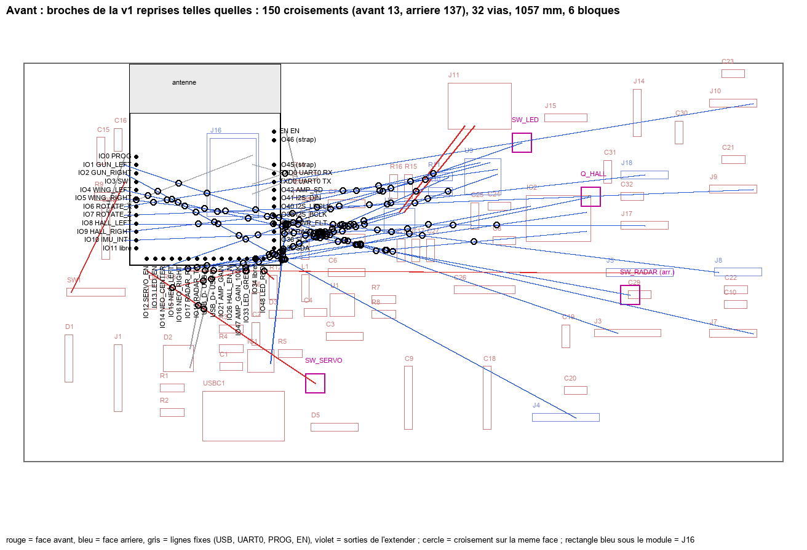
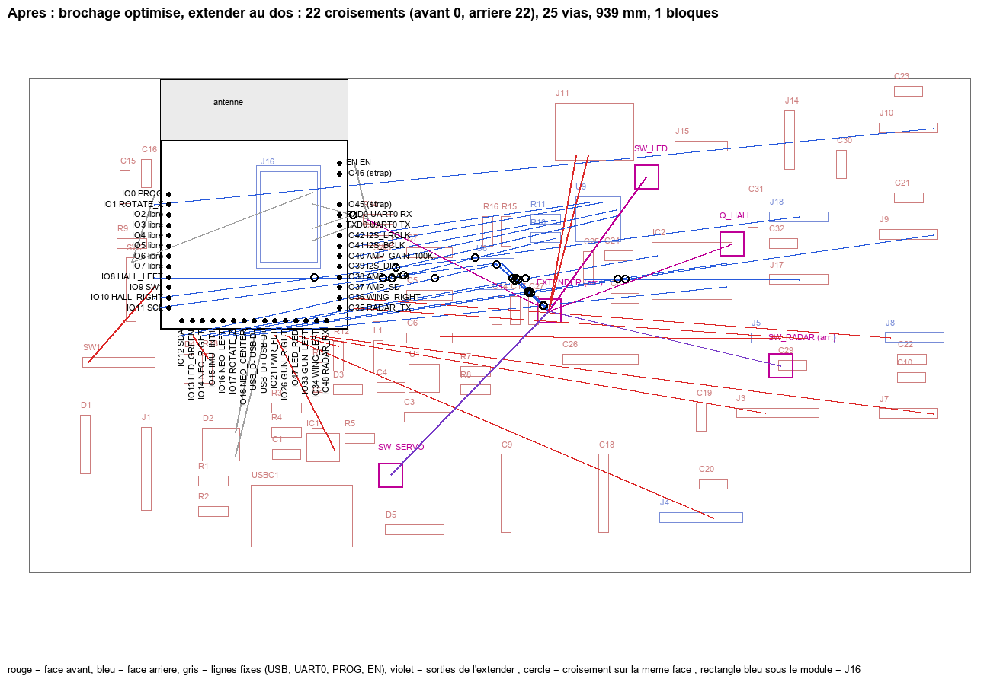
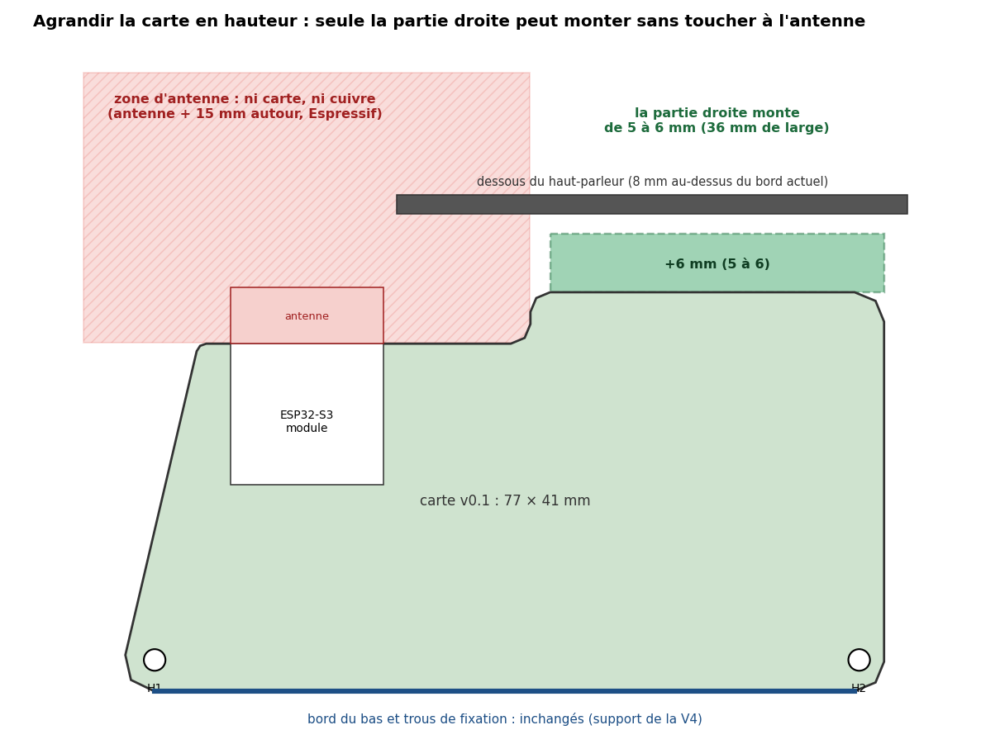

# Carte Turret2 v2 — plan matériel

> **Guide d'exécution dans KiCad, étape par étape : [carte-v2-kicad.md](carte-v2-kicad.md).**
>
> **Statut : plan, rien n'est fabriqué.** Rédigé le 21.10.2026 à partir de [AMELIORATIONS_V2.md](AMELIORATIONS_V2.md) (propositions), des décisions de l'utilisateur et du projet KiCad v0.1 du dépôt (`Turret2_portable/`, commit `8248fcd`). Les valeurs marquées **[DS]** ont été relues dans la datasheet les 21 et 22.10.2026 (sources en fin de document) ; celles marquées **[à vérifier]** n'ont pas pu l'être.
>
> Si le projet KiCad maître (hors dépôt) a changé depuis le 25.09.2026, les numéros de composants v0.1 cités ici (R4, C9…) sont à revérifier.
>
> **Mis à jour le 21.10.2026 (soir)** : brochage refait pour faciliter le routage, et extendeur de GPIO intégré au plan principal (§4.9, §5). L'étude est reproductible avec `Turret2_portable/tools/gpio_study/`.
>
> **Mis à jour le 22.10.2026** : R18 à 100 Ω (changée le 19.10.2026) dans le §5 et le §12 ; LEDs d'état en deep sleep (§1.1) ; total de la veille profonde aligné entre le §1 et le §1.1 ; pièces manquantes ajoutées à la liste d'achat (§3.1). Puis : capteurs Hall identifiés, **OH49E** (§4.3, datasheet relue) ; sentinelle abandonnée définitivement, faute de place (§0, §3.3, §12).
>
> **Revue avant gel, 22.10.2026** : relevé des composants et des nets de la v0.1 dans KiCad, et relecture des datasheets TPS2595, TPS22965, TPS631000, TCAL6416 et MAX98357A. Principaux changements : pont de retour du TPS631000 à 511 kΩ / 91 kΩ (§4.10, nouveau), pull-down sur IO26 (§5), consommation de la veille radar avec le point d'accès Wi-Fi (§1), adresse et registres de l'extendeur vérifiés (§4.9), condensateurs de la v0.1 répartis sur les rails (§2), position des switches (§0, §5.1, §8), garde-fou de carte dans le firmware (§10), renvois de section corrigés. Puis, à la demande de l'utilisateur : pull-downs des autres lignes PWM **en option** selon la place (§4.8), et résistance de 0 Ω en 2512 gardée pour le pont de mesure, donnée pour ≥ 4 A (§3.1, §8). Ensuite : zones d'alimentation (§8) et **second port I²C J19**, Qwiic vertical Adafruit 4328 (§0, §3.1, §6, §11).
>
> **Mis à jour le 23.10.2026** : **USB-C de la carte retiré** (USBC1, R1, R2, D5) après des faux contacts répétés ; seule entrée, l'USB déporté **J1, passé en JST-XH 4 broches** (3 A par contact, 22 AWG) (§0, §1.1, §2, §3, §7, §8, §11). Puis : **carte agrandie vers le haut, partie droite seulement** (zone d'antenne inchangée) ; « tout au recto » à décider au placement (§0, §8, §11).

---

## 0. Résumé

**Objectif** : pouvoir couper ce qui consomme (servos, LEDs, radar, capteurs Hall) et mettre l'ESP32 en deep sleep sous 1 mA, sans perdre de fonction.

| Décision | Choix | Pourquoi |
|---|---|---|
| Radar | **RD-03D seul** (Ai-Thinker, déjà monté), **pas de radar sentinelle** | choix de l'utilisateur (21.10.2026), **définitif le 22.10.2026 : pas de place pour un second module** ; le LD2410S n'est pas acheté |
| Coupure des rails | 3 × **TPS22965** (servos, anneau LED, radar) + 1 × **AO3401A** (capteurs Hall) | 6 A pour les servos ; ON compatible 3,3 V ; coupés au reset grâce aux pull-downs |
| Protection d'entrée | eFuse **TPS259533** à la place du TPS259573 (même boîtier, même brochage) | sortie **écrêtée à 5,2–5,7 V** : tout le +5V reste sous 6 V, le maximum absolu des switches, du TPS631000 et de l'ampli, sans toucher au diviseur (§4.2) |
| GPIO | **brochage refait pour le routage** (étude §5.1) ; **extendeur I²C TCAL6416 au dos**, à côté de l'IMU, pour les 4 commandes de rails | 4 lignes de moins à sortir du module ; le côté gauche du module, le plus mal placé, est presque vide ; bus groupés ; ampli face à l'ampli. Variante sans extendeur en §9 |
| Boutons | **A et B supprimés**, **SW1 gardé**, PROG (SW2) gardé | interface par la page web ; le knob et l'OLED ne sont que des outils de debug sur le Qwiic |
| Ports I²C | J11 (Qwiic coudé, inchangé) + **J19, second port Qwiic vertical** (Adafruit 4328) | demande de l'utilisateur (22.10.2026) ; même bus, mêmes 4 nets (§6) |
| Entrée USB | **USB-C de la carte (USBC1) retiré** avec R1, R2 (5,1 kΩ du CC) et D5 ; seule entrée : l'USB déporté **J1, passé en JST-XH 4 broches** (3 A par contact, VBUS et GND en 22 AWG) | décision du 23.10.2026 : faux contacts répétés sur l'USB-C (D−) ; J1 porte déjà tout le courant en usage normal, et ses pointes (~3 A) dépassaient les 2 A du JST-PH ; plus de risque de deux sources en parallèle ; place libérée près de l'eFuse (§2) |
| Contour | **la partie droite monte de 5 à 6 mm**, à droite de la zone d'antenne seulement (36 mm de large ; le dessous du haut-parleur est à 8 mm du bord actuel, mesuré dans Fusion : 6 mm laissent 2 mm de marge) ; carte de 77 × 41 à 77 × 47 mm ; bord du bas, trous H1 / H2, côtés et zone d'antenne inchangés (§8). **Fait** : h = 6 mm, 77,3 × 46,6 mm, troisième trou M2 **H3** en haut à droite ; modèle 3D `Turret2_portable/3d/Turret2_rehausse.step` | décision du 23.10.2026 : de la place sous la coque au-dessus de la carte ; l'antenne de l'ESP32 interdit de monter à gauche ; déplacer le module pour monter partout a été écarté |
| Face arrière | IMU (U6), ampli (U9), extendeur et SW_RADAR au verso ; SW_SERVO, SW_LED et le P-MOS des capteurs Hall au recto **(à revoir avec la carte agrandie : si la place suffit, tout au recto)** | le chemin de puissance des servos reste au recto ; SW_RADAR (≈ 110 mA) à côté de J5, déjà au verso ; le verso venait du manque de place au recto |
| Corrections v0.1 | entrées Hall et NeoPixel tirées, pull-up sur IO0, pull-down sur IO26, résistances série sur les lignes qui sortent de la carte, TVS à faible fuite, pont de retour du TPS631000 à 511 kΩ / 91 kΩ | broches flottantes, protection des GPIO, budget de veille (le pont de la v0.1 consomme 50 µA en permanence) |

---

## 1. Modes de veille avec le RD-03D seul

Sans radar sentinelle, la carte ne peut pas « voir » quelqu'un en deep sleep : le RD-03D consomme ~110 mA en continu et n'a pas de mode veille (voir B9 dans [firmware-improvements.md](firmware-improvements.md)). D'où trois modes :

| Mode | Allumé | Coupé | Réveil / sortie | Consommation (5 V) |
|---|---|---|---|---|
| **Actif** | tout | — | — | selon les mouvements (pointes de servos ~3 A) |
| **Veille radar** | RD-03D, ESP32 (CPU ralenti ; Wi-Fi coupé, en station ou en point d'accès) | servos, anneau LED, capteurs Hall, ampli (SD bas) | une cible du RD-03D, la page web, PROG | **≈ 130–150 mA** Wi-Fi coupé ou en station ; **≈ 170–200 mA** en point d'accès **[estimations]** |
| **Veille profonde** | IMU en mode réveil, ESP32 en deep sleep | tout le reste, radar compris | **IMU** (on tape ou on bouge la tourelle) sur IO15 ; **minuterie RTC** ; option **touche tactile** sur IO2 (§5) | **≈ 0,2–0,35 mA** avec des TVS à faible fuite (§1.1) |

**Wi-Fi en veille radar** : la page web suppose le Wi-Fi allumé. En **station** (réseau de la maison), la veille du modem ramène l'ESP32-S3 à ~20–40 mA sur le 3,3 V (tableau ESP-IDF, DTIM 1 à 3). En **point d'accès** (réseau « Portal Turret »), il n'y a pas de veille du modem (ESP-IDF : « Modem-sleep mode works in station-only mode ») : la radio écoute en permanence, d'où l'estimation plus haute, **à mesurer**. Pour une veille radar économe : couper le point d'accès, ou passer par le réseau de la maison.

**Option « ronde » en veille profonde** : réveil par minuterie toutes les *T* secondes, radar allumé pendant *t* secondes (le temps de démarrage du RD-03D est à mesurer), puis retour au deep sleep si personne. Moyenne ≈ (110 mA + ~40 mA d'ESP32) × *t* / *T*. Exemple : *t* = 2 s, *T* = 60 s → **≈ 5 mA** ; *T* = 30 s → ≈ 10 mA. Le temps de réaction est alors de *T* au pire.

Exemple d'usage : veille radar le jour, veille profonde la nuit (heure NTP), réveil par l'IMU à tout moment.

### 1.1 Bilan de la veille profonde

| Poste | Courant | Source |
|---|---|---|
| eFuse TPS259533, quiescent | 175 µA typ., 250 µA max | [DS] valeur commune à toutes les variantes, x3 comprise (cellule fusionnée du tableau 7.5, relu le 22.10.2026) ; premier poste de la veille |
| Diode TVS D1 (SMAJ5.0A) sur VBUS (D5 retirée avec l'USB-C) | **jusqu'à 800 µA** (IR max à 5,0 V) | [DS] Vishay ; en pratique souvent bien moins : **à mesurer**. Remplacement proposé en §7 |
| 3 × TPS22965 coupés | 3 × 7 µA max (VBIAS 2 µA + VIN 5 µA ; VIN : 0,005 µA typ.) | [DS] |
| AO3401A coupé (Hall) | fuite < 1 µA | [DS] |
| Extendeur TCAL6416 au repos | ~1 µA typ. | [DS] |
| MAX98357A, SD_MODE bas | 0,6 µA typ., 2 µA max | [DS] — attention : **340 µA** si SD_MODE est haut sans horloge (mode standby) |
| SN74AHCT125, entrées à la masse | 2 µA max à 25 °C | [DS] |
| ESP32-S3, deep sleep, réveil EXT1 | ~10–20 µA | ordre de grandeur Espressif **[à mesurer]** |
| TPS631000 (3,3 V) en mode économie (MODE = GND, vérifié dans KiCad) | 8 µA typ. (dans VOUT, sans commutation) | [DS] |
| Pont de retour du TPS631000 (R7 / R8) | v0.1 : 56 kΩ / 10 kΩ → **50 µA** ; v2 : 511 kΩ / 91 kΩ → 5,5 µA (sur le 3,3 V) | §4.10 |
| LSM6DSOX en mode réveil | quelques µA à quelques dizaines selon l'ODR | **[à vérifier]** |
| Diviseur OVLO de l'eFuse (R3 1 MΩ + R4 249 kΩ, sur VBUS) | 4 µA | permanent |
| Résistances de tirage des rails et des bus | 0 (EN bas, bus I²C au repos haut) | — |
| SW1 fermé (R9 10 kΩ) | 330 µA | à éviter : **laisser SW1 ouvert** en usage normal |
| LEDs d'état D3, D4 | 0 si éteintes avant le deep sleep | IO47 (rouge) n'est pas RTC : flottante en deep sleep. IO13 (verte) est RTC : ne pas la maintenir haute (`gpio_hold`, `rtc_gpio`) |
| Capteurs Hall (2 × OH49E) | **0 si coupés** ; sinon 2 × 4,2 mA typ. (valeur à 5 V ; sous 3,3 V, à mesurer) | [DS] Ouzhuo ; d'où le P-MOS `HALL_EN_N` (§2, §4.3) |
| Modules Qwiic (OLED, knob) | 0 : **débranchés en usage normal** (debug seulement) | décision de l'utilisateur |
| **Total** | **≈ 0,2–0,35 mA** avec des TVS à faible fuite et le nouveau pont du TPS631000 ; ≈ 40 µA de plus avec le pont de la v0.1 ; jusqu'à ~1,1 mA dans le pire cas de la SMAJ5.0A | courants du 3,3 V ramenés au 5 V (× 3,3 / 5 / rendement ~0,8, soit × 0,8 environ) |

---

## 2. Architecture d'alimentation v2

```
J1 (USB déporté, JST-XH) ──┬─ D1 TVS (§7) ──► 0 Ω 2512 (§8) ──► IC1 eFuse TPS259533 ──► +5V (sortie ≤ 5,7 V, limite ≈ 3,9 A)
                           └─ D2 USBLC6 (D+, D−)              R3 1 MΩ / R4 249 kΩ : OVLO 5,67–6,37 V (garde-fou)

 +5V ───┬── SW_SERVO  TPS22965, CT 4,7 nF ─► 5V_SERVO ─► C9, C18 (2 × 220 µF) ─► J7–J10 servos
        │                                                                     └► J3, J4 canons (servo + 2 LEDs, même broche +5 V)
        ├── SW_LED    TPS22965, CT 1 nF ───► 5V_LED ───► 10 µF + C30 ─► J14 anneau (9 LEDs)
        ├── SW_RADAR  TPS22965, CT 1 nF ───► 5V_RADAR ─► 10 µF + C29 ─► J5 RD-03D
        ├── U9 MAX98357A + C24, C25, C26 (non commuté ; SD_MODE bas en veille = 0,6 µA)
        ├── IC2 SN74AHCT125 (non commuté ; entrées tirées à la masse)
        └── U1 TPS631000 ─► +3V3 ─┬─ ESP32-S3, LSM6DSOX, extendeur TCAL6416, pull-ups I²C, J11 Qwiic (debug)
                                  └─ AO3401A (HALL_EN_N) ─► 3V3_HALL ─► C31, C32 ─► J17, J18

Commandes des rails : SERVO_EN, LED_EN, RADAR_EN, HALL_EN_N = sorties P00–P03 de l'extendeur (I²C), au dos.
U1 TPS631000 : pont de retour R7 / R8 à 511 kΩ / 91 kΩ en v2 (§4.10).
```

**Entrée unique J1** (23.10.2026) : l'USB-C de la carte (USBC1), ses deux 5,1 kΩ du CC (R1, R2) et la seconde TVS (D5) disparaissent. Tout arrive par la prise USB-C déportée (Adafruit ADA6050, 5,1 kΩ du CC déjà montées : les chargeurs USB-C restent reconnus) et J1, qui passe du JST-PH (2 A par contact, 24 AWG au plus) au **JST-XH 4 broches** (3 A par contact, 22 AWG ; empreinte `Connector_JST:JST_XH_B4B-XH-A_1x04_P2.50mm_Vertical`), même brochage : 1 VBUS, 2 D+, 3 D−, 4 GND. Câble : VBUS et GND en **22 AWG** (≈ 16 mΩ aller-retour sur 15 cm, 0,05 V à 3 A), D+ / D− torsadés en 26–28 AWG, à l'écart des fils de puissance. D1 (TVS) et D2 (USBLC6) restent **au plus près de J1**. Pour travailler sur la carte hors de la tourelle : une ADA6050 de rechange câblée sur une fiche XH (câble de banc) ; en secours, l'OTA et J16 (UART0, qui n'alimente pas la carte). Limite connue : la seule prise USB est à 15 cm de D1 / D2, une décharge électrostatique parcourt le câble avant d'être écrêtée (design-plan §10).

**Condensateurs de la v0.1** (relevé KiCad du 22.10.2026) : C9 et C18 (OS-CON 220 µF 16 V) et les 100 nF des connecteurs de servos (C10, C19–C23) passent sur 5V_SERVO ; C30 (100 nF, à côté de J14) sur 5V_LED ; C29 (100 nF, à côté de J5) sur 5V_RADAR. Restent sur le +5V non commuté : C24, C25 (10 µF) et C26 (100 µF) de l'ampli, C3 (22 µF) et C4 à l'entrée du TPS631000, et les autres 100 nF.

**Le connecteur des canons (J3, J4) n'a qu'une broche +5 V**, partagée par le servo et les 2 LEDs du canon (relevé dans `Turret2.kicad_pcb` : 1 = +5V, 2 = PWM, 3 = données LED, 4 = GND). Les LEDs des canons sont donc sur `5V_SERVO`. Pour les séparer, il faudrait un connecteur à 5 broches et un câble refait ; ce n'est pas nécessaire : en veille, tout est coupé de toute façon.

**Courants d'appel** (I ≈ C × 5 V / t_R, t_R lu dans le tableau 1 de la datasheet [DS], VIN = 5 V) :

| Switch | Capacité en aval | CT | t_R | Pointe |
|---|---|---|---|---|
| SW_SERVO | ~440 µF (C9 + C18) + 6 × 100 nF | 4,7 nF | 8,2 ms | ≈ 0,27 A |
| SW_LED | ~10 µF + découplage de l'anneau | 1 nF | 2,0 ms | ≈ 25 mA |
| SW_RADAR | ~10 µF + entrée du module (inconnue) | 1 nF | 2,0 ms | < 0,1 A |

La limite de l'eFuse est **≈ 3,9 A** (R5 = 523 Ω ; déduit des points de la datasheet : 487 Ω → 4,17 A typ. [DS]). Toujours allumer les switches **un par un**, à ≥ 10 ms d'écart.

**Ordre de mise sous tension et de coupure** (firmware, §10) :

- Coupure : arrêter le PWM des servos et passer leurs broches à l'état bas → LEDs à noir puis lignes de données à l'état bas → `SERVO_EN`, `LED_EN` bas → UART du radar arrêté, sa broche TX (IO35) en entrée → `RADAR_EN` bas → `HALL_EN_N` haut → ampli : SD (IO37) bas avant d'arrêter l'I²S.
- Allumage : dans l'ordre inverse, un switch à la fois.

Raison des étapes « lignes à l'état bas » : une ligne de signal à l'état haut vers un module non alimenté le **rétro-alimente** par ses diodes de protection (servo, LED, radar).

---

## 3. Liste d'achat

### 3.1 À acheter

| Qté (+ réserve) | Composant | Référence | Boîtier | Rôle |
|---|---|---|---|---|
| 3 (+2) | Load switch 6 A, 16 mΩ, **avec QOD** | TI **TPS22965DSGR** (pas la version N) | WSON-8 2 × 2 mm, pad thermique | SW_SERVO, SW_LED, SW_RADAR |
| 1 (+1) | eFuse 2,7–18 V, écrêtage 5,7 V, EN actif bas | TI **TPS259533DSGR** | WSON-8 2 × 2 mm (comme IC1) | remplace TPS259573 |
| 1 (+2) | P-MOS 30 V, 4 A | AOS **AO3401A** | SOT-23 | alimentation des capteurs Hall |
| 1 (+1) | Extendeur I²C 16 E/S, RESET, 1,08–3,6 V | TI **TCAL6416** (TSSOP-24, PW) ou NXP **PCAL6416A** | TSSOP-24 | commandes des rails (§4.9) |
| 2 (+2) | 100 nF 25 V X7R | — | 0603 | découplage VCCI et VCCP de l'extendeur |
| 1 (+2) | 4,7 nF **25 V X7R** | — | 0603 | CT de SW_SERVO (25 V minimum [DS]) |
| 2 (+2) | 1 nF **25 V X7R** | — | 0603 | CT de SW_LED et SW_RADAR |
| 3 (+2) | 1 µF 25 V X7R | — | 0603 | CIN des switches (au ras de VIN) |
| 3 (+2) | 100 nF 25 V X7R | — | 0603 | VBIAS des switches (5V_RADAR et 5V_LED reprennent C29 et C30, §2) |
| 4 (+2) | 10 µF 25 V X7R | — | 0805 ou 1206 | sortie 5V_LED, 5V_RADAR ; 10 µF du MAX98357A s'il ne suit pas ; 10 µF sur VDD du LSM6DSOX si la datasheet ST le confirme (§4.5) |
| 12 (+5) | 100 kΩ 1 % | — | 0603 | pull-downs : 3 × EN, 3 × entrées AHCT, 2 × Hall ; pull-up : grille Hall ; réserve |
| 2 (+2) | 10 kΩ 1 % | — | 0603 | pull-up de IO0 (recommandé par Espressif) ; pull-down de IO26 (§5) |
| 1 (+2) | 511 kΩ 1 % | — | 0603 | R7, haut du pont de retour du TPS631000 (§4.10) |
| 1 (+2) | 91 kΩ 1 % | — | 0603 | R8, bas du pont de retour du TPS631000 (§4.10) |
| 9 (+3) | 330 Ω | — | 0603 | série : 6 PWM servos, 3 données NeoPixel |
| 2 (+2) | 1 kΩ | — | 0603 | série : UART du radar |
| 1 (+1) | TVS 6,5 V | Vishay / Littelfuse **SMAJ6.5A** | SMA (comme D1) | remplace SMAJ5.0A (§7) ; D5 disparaît avec l'USB-C |
| 1 (+2) | Embase JST-XH 4 broches verticale | JST **B4B-XH-A** | traversant, pas de 2,5 mm | J1, entrée USB déportée (§2) |
| 2 (+2) | Boîtier JST-XH 4 voies et contacts à sertir | JST **XHP-4** + contacts SXH (série adaptée au 22 AWG **[à vérifier]**) | — | câble de la prise déportée et câble de banc |
| 1 (+1) | Résistance 0 Ω **donnée pour ≥ 4 A** | — | 2512 | pont de mesure du courant de veille, juste après D1 (§8). Les 0 Ω 2512 courantes (ex. Yageo RC2512…) ne tiennent que 2 A : vérifier le courant nominal, ou prendre une résistance de mesure métallique de 1 à 5 mΩ dans le même boîtier (4 A → 4 à 20 mV, 80 mW au plus) |
| *option* 5 (+2) | 100 kΩ 1 % | — | 0603 | pull-downs des cinq lignes PWM sans tirage au reset (§4.8), selon la place |
| 1 lot de 10 | Connecteur Qwiic vertical, JST SH 4 broches, pas de 1 mm, CMS | Adafruit **4328** (Kaweei CCSH-W10-04-BK-RC) | empreinte du JST BM04B-SRSS-TB | J19, second port I²C (§6) ; 1 A max, ~4,6 mm de haut |
| 1 | Pâte basse température **Sn42Bi58** | — | seringue | brasage du verso (§8) |
| 1 | Second pochoir (verso) | JLCPCB | — | brasage du verso |

### 3.2 Retirés de la v0.1

J12, J13 (boutons A et B), R13, R17 (1 kΩ série), R19, R20 (pull-ups 10 kΩ), C11, C12 (100 nF). Depuis le 23.10.2026 : **USBC1** (USB-C de la carte), **R1, R2** (5,1 kΩ du CC), **D5** (seconde TVS). J1 change d'empreinte (JST-PH → JST-XH).

### 3.3 Prévus par AMELIORATIONS_V2.md mais **à ne pas acheter**

| Pièce | Pourquoi |
|---|---|
| HLK-LD2410S + AO3401A + cavalier + JST-SH | pas de radar sentinelle (RD-03D seul) : pas de place pour un second module dans la tourelle |
| 2N7002 + 10 kΩ (`LED_OE_N`) | inutile : les pull-downs sur les entrées de l'AHCT suffisent (§4.6) |
| 274 kΩ (R4) | rejeté : avec la tolérance de l'eFuse, coupure possible dès 5,25 V (§4.2) |
| 100 kΩ sur `AMP_SD` | le MAX98357A a déjà un pull-down interne de 100 kΩ sur SD_MODE [DS] |

---

## 4. Fiches composants : découplage et résistances

### 4.1 TPS22965 (× 3) — load switches

Brochage (WSON-8, vue de dessus) [DS] : 1, 2 = VIN ; 3 = ON ; 4 = VBIAS ; 5 = GND ; 6 = CT ; 7, 8 = VOUT ; pad thermique = GND.

| Broche | Raccordement | Règle de la datasheet [DS] |
|---|---|---|
| VIN (1 + 2) | +5V, en aval du point d'étoile ; **1 µF X7R au ras des broches** | « 1 µF usually sufficient » ; idéal CIN ≈ 10 × CL, non obligatoire |
| VBIAS (4) | **+5V** (même rail que VIN), 100 nF | 2,5–5,7 V ; R_ON spécifié pour VBIAS = 5 V ; garder VIN ≤ VBIAS |
| ON (3) | sortie de l'extendeur + **100 kΩ vers GND** | « Do not leave floating » ; VIH 1,1 V, VIL 0,5 V : compatible 3,3 V ; fuite 0,5 µA. Le pull-down tient le switch coupé quand les ports de l'extendeur sont en entrée (mise sous tension, RESET) |
| CT (6) | condensateur **X7R 25 V** vers GND, piste très courte | la tension sur CT peut monter à 12 V |
| VOUT (7 + 8) | rail commuté | avec QOD : 225 Ω de décharge quand le switch est coupé |
| Pad thermique | GND, vias (Ø 0,2–0,3 mm) | 3 A × 3 A × 16 mΩ ≈ 0,14 W |

- **Valeurs** : abs. max 6 V, recommandé 5,7 V ; 6 A continu, 8 A en impulsion ; IQ 50 µA (allumé) ; coupé : 2 µA max sur VBIAS + 5 µA max sur VIN [DS].
- **CL > CIN** sur SW_SERVO (440 µF en aval) : la datasheet l'admet mais conseille alors **un CT plus grand** pour limiter la chute de VIN → 4,7 nF.
- **QOD** : choisir TPS22965 et non TPS22965N, pour que les rails coupés retombent vraiment à 0 V (pas de servo ni de radar à moitié alimenté).
- **Alternative plus facile à souder** pour SW_LED et SW_RADAR : TPS22918 (SOT-23-6, 2 A, 52 mΩ, IQ 8,7 µA) [DS], mais VIN recommandé 5,5 V max (5,7 V possible pendant un écrêtage de l'eFuse, sous les 6 V abs. max). Un seul modèle (TPS22965) simplifie la commande.

### 4.2 TPS259533 — eFuse (remplace le TPS259573, IC1)

- **Même boîtier et même brochage** : la broche 2 est EN/OVLO, active basse, sur toutes les variantes x3 [DS]. Le diviseur R3 / R4 reste utilisable.
- **Écrêtage** : se déclenche à 5,5–5,9 V et maintient la sortie à **5,2–5,7 V** [DS], en ~5 µs. En écrêtage, l'eFuse dissipe (VIN – 5,45 V) × I, puis coupe en surchauffe et réessaie toutes les 93 ms.
- **Diviseur OVLO** : garder **R4 = 249 kΩ** (seuil 1,13–1,27 V [DS] → coupure à 5,67–6,37 V) comme seconde ligne. La valeur de 274 kΩ proposée dans AMELIORATIONS_V2.md (attribuée par erreur à R6, qui est le pull-up de PWR_FLT) donnerait 5,25–5,91 V : **coupure possible sur un chargeur USB à 5,25 V**.
- **Limite de courant** : R5 = 523 Ω → ≈ 3,9 A ; R_ILM minimum 487 Ω, qui donne 3,87–4,42 A [DS]. dVdt : C2 47 nF inchangé.
- **Pendant un écrêtage** (sortie ≤ 5,7 V), tout le +5V reste sous 6 V, le maximum absolu des TPS22965, du TPS631000 et du MAX98357A (7 V pour l'AHCT) [DS]. TPS631000, MAX98357A et AHCT sont alors au-dessus de leur plage recommandée (5,5 V) : acceptable pendant un défaut, pas en continu. Avec le TPS259573 de la v0.1 (sans écrêtage, OVLO jusqu'à 6,37 V), ces 6 V pouvaient être dépassés.
- **Courant de repos** : 175 µA typ., 250 µA max, commun à toutes les variantes [DS] ; premier poste de la veille profonde (§1.1).
- **Entrée** : abs. max 20 V [DS] ; aucune contrainte nouvelle pour les TVS.

### 4.3 AO3401A — alimentation des capteurs Hall

**Capteurs** : 2 × **OH49E** (Nanjing Ouzhuo, compatible SS49E), d'après la liste de matériel du projet d'origine ; capteurs linéaires, en fils volants dans les rails des ailes. Datasheet [DS] :

| Paramètre | Valeur | Conséquence |
|---|---|---|
| VCC | 2,3 à 10 V (abs. max 10 V) | 3,3 V convient |
| ICC | **4,2 mA typ. à 5 V**, pas de max ; rien sous 3,3 V | ≈ 8 mA pour les deux si on ne les coupe pas ; un peu moins à 3,3 V (la datasheet note que le courant croît avec VCC) : à mesurer |
| Sortie au repos (B = 0) | VCC / 2 (2,35–2,65 V à 5 V) | ≈ 1,65 V sous 3,3 V : bien distincte du 0 V du pull-down de 100 kΩ (capteur absent ou coupé) |
| Sensibilité | 1,8–2,2 mV/G à 5 V | proportionnelle à VCC : plus faible sous 3,3 V, déjà compensée par la calibration du firmware |
| Sortie | émetteur suiveur, 40–100 Ω | le pull-down de 100 kΩ ne la charge pas |
| Temps de démarrage | non donné | à mesurer |

- Source sur +3V3, drain sur 3V3_HALL (J17.1, J18.1, avec C31, C32 déplacés côté commuté, au ras des connecteurs).
- Grille sur **P03 de l'extendeur (`HALL_EN_N`)** + **100 kΩ vers +3V3** : coupé par défaut. Les ports de l'extendeur sont des entrées à la mise sous tension et après un RESET [DS] : la résistance tient alors le P-MOS coupé. Elle le tient aussi en deep sleep.
- V_GS = –3,3 V : R_DS(on) < 85 mΩ à –2,5 V, seuil –0,5 à –1,3 V [DS]. Aucune résistance de grille nécessaire (charge de grille ~7 nC, ligne lente).
- Firmware : allumer, attendre ~1 ms **[durée de démarrage de l'OH49E : absente de la datasheet, à mesurer]**, lire, et couper quand les ailes ne bougent pas, si la consommation le justifie.

### 4.4 MAX98357A — ampli (déplacé au verso)

- **Découplage** : 10 µF + 0,1 µF sur VDD (7, 8) [DS, schémas d'application]. Sur la v0.1, C25 (10 µF) et C24 (100 nF) sont à côté de l'ampli : à déplacer avec lui, au ras des broches. C26 (100 µF, réservoir) peut rester au recto, au pied du via. VDD : 2,5–5,5 V, 6 V max absolu [DS].
- **SD_MODE** : pull-down interne de **92–108 kΩ** [DS]. Garder **R10 = 2 kΩ** en série depuis la GPIO : 3,3 V × 100 / 102 ≈ 3,24 V → canal gauche. GPIO flottante → arrêt. **Aucun pull-down externe nécessaire.**
- **GAIN_SLOT** : même montage, mais sur **IO38 en direct et IO40 par R11 = 100 kΩ** (v0.1 : IO21 et IO47), **toujours en drain ouvert**. Gains [DS] : non connecté 9 dB, GND 12 dB, GND par 100 kΩ 15 dB, VDD 6 dB, VDD par 100 kΩ 3 dB. Garder R11 près de l'ampli. IO38 et IO40 n'ont ni pull-up ni glitch au démarrage (Espressif).
- **Courants** : arrêt 0,6 µA ; **standby 340 µA** si SD_MODE est haut sans BCLK [DS] → toujours mettre SD bas avant d'arrêter l'I²S (règle déjà appliquée).
- **Pad exposé** : non relié en interne, à mettre au GND par des vias pour la dissipation [DS].
- **Sorties HP** : courtes et en paire jusqu'à J15. Option CEM : emplacements pour des ferrites (0603) en série sur OUTP / OUTN si le câble du HP est long.

### 4.5 LSM6DSOX — IMU (déplacée au verso)

- **Découplage** : 100 nF au plus près de VDD (8) et 100 nF au plus près de VDDIO (5) ; un 10 µF sur VDD est souvent recommandé par ST. **[datasheet ST non téléchargeable les 21 et 22.10.2026 : à vérifier]**
- **Broches** : inchangées et correctes sur la v0.1. SDO/SA0 au GND (adresse 0x6A) ; CS au +3V3 (mode I²C) ; SDx, SCx au GND ; INT2, OCS_Aux, SDO_Aux non connectés (tirages internes actifs par défaut).
- **Pastilles 9 et 10** : soigner le pochoir ; un pont de soudure entre elles a été vu sur la deuxième carte (sans conséquence, voir firmware-improvements.md, 21.10.2026).
- **Mécanique** : au centre de la carte, loin des vis M2, des connecteurs et des sources de chaleur (ampli, TPS631000, switches). **Ni via ni piste sous le boîtier LGA** (contraintes, et bonne pratique ST).
- **Axes** : retournée au verso, Z s'inverse ainsi que X ou Y → matrice de correction dans `Motion` (§10).
- **INT1** → IO15 (réveil EXT1). Configurer l'interruption de réveil en mode **verrouillé** (latched), pour qu'une impulsion courte ne soit pas manquée.
- **INT1 au démarrage** : « INT1 must be set to '0' or left unconnected during power-on if the I²C/SPI interfaces are used » (datasheet du LSM6DSO, même famille ; même note citée pour le LSM6DSOX). IO15 n'a ni pull-up ni pilotage au reset : garder ainsi (pas de pull-up externe, IO15 jamais en sortie).

### 4.6 SN74AHCT125 — tampon NeoPixel (inchangé)

- VCC sur +5V non commuté, 100 nF au ras de la broche 14 [DS : « good bypass capacitor »].
- **Entrées 1A, 2A, 3A : 100 kΩ vers GND** (nouveau). Sur la v0.1, elles flottent pendant le boot et en deep sleep (GPIO en haute impédance) [DS : « all unused inputs must be held at VCC or GND »]. Avec les pull-downs, les sorties restent à l'état bas : pas de rétro-alimentation des LEDs coupées, pas de consommation parasite.
- /OE : **restent à la masse** comme sur la v0.1 (l'inverseur 2N7002 proposé devient inutile).
- 4ᵉ porte : 4A et 4/OE au GND, 4Y en l'air : déjà correct sur la v0.1.
- **Sorties 1Y, 2Y, 3Y : 330 Ω en série** près de l'AHCT (nouveau) : amortit les réflexions sur les câbles et limite le courant dans la diode d'entrée d'une LED non alimentée. Bonne pratique courante pour les WS2812 / SK6812.
- ΔICC = 1,35 mA par entrée à 3,4 V [DS] : sans importance tant que l'ESP32 tient la ligne à l'état bas au repos (protocole NeoPixel).
- **Attribution des portes libre** : n'importe quelle porte peut piloter n'importe quelle chaîne de LEDs. Les entrées 1A / 2A sont d'un côté du boîtier, 3A / 4A de l'autre : choisir les portes au routage pour éviter les croisements.

### 4.7 ESP32-S3-MINI-1-N8 — rappels

- EN : 10 kΩ + 1 µF (R14, C13) = valeurs recommandées par Espressif ✓.
- 3V3 : 10 µF + 100 nF au ras de la broche 3 ✓ (C15, C16).
- **IO0** : ajouter **10 kΩ vers +3V3**. Espressif : « It is recommended to place a pull-up resistor at the GPIO0 pin » (*Schematic Checklist*, section *Strapping Pins*). La v0.1 n'a que le pull-up interne, de **45 kΩ** [DS, datasheet ESP32-S3], actif au reset ; il suffit en pratique (boots normaux sur les deux cartes), la résistance externe n'est qu'une marge contre les parasites au moment du reset. « Do not add high capacitors at GPIO0, or the chip may enter download mode » : pas de condensateur d'anti-rebond sur PROG.
- Glitchs au démarrage : IO1–IO14, IO17, IO18 font une impulsion basse d'environ 60 µs à la mise sous tension (Espressif). En v2, ça concerne surtout **SCL / SDA (IO11, IO12)** : récupération du bus I²C au boot (§10). Sans effet sur les PWM et les NeoPixel, dont les rails sont coupés à ce moment-là.

### 4.8 Lignes qui sortent de la carte

| Ligne | Ajout | Raison |
|---|---|---|
| PWM servos (IO1, IO17, IO26, IO33, IO34, IO36) | 330 Ω en série, **près du connecteur** | un +5V touchant la broche de signal (sur tous les connecteurs de servos, le +5V est voisin du signal : J7–J10 broches 2 et 3, J3 / J4 broches 1 et 2) ne détruit plus la GPIO (courant limité à quelques mA) ; moins de rétro-alimentation quand le rail est coupé |
| UART du radar (RX IO48, TX IO35) | 1 kΩ en série, **près de J5** | le radar coupé n'est plus alimenté par sa ligne RX à l'état haut (≤ 3,3 mA) ; protection ESD |
| Hall (IO8, IO10) | 100 kΩ vers GND, près de J17 / J18 | capteur débranché ou coupé → lecture ≈ 0, détectée par l'auto-test (sur la v0.1, une entrée en l'air passe l'auto-test, vu le 21.10.2026). Option : RC 1 kΩ / 10 nF contre le bruit des moteurs |

Les résistances série vont **près des connecteurs**, pas au pied du module : la limitation de courant est la même, et le pourtour du module est la zone la plus chargée de la carte.

**Option, selon la place : 100 kΩ → GND sur IO1, IO17, IO33, IO34 et IO36**, à côté de leur 330 Ω. Ces broches n'ont aucun tirage au reset (IE seulement, tableau des broches de la datasheet ESP32-S3 [DS]) : pendant un redémarrage, leurs lignes flottent au lieu d'être basses, alors que le rail des servos peut rester allumé après un redémarrage logiciel (§4.9). La v0.1 vit ainsi à chaque démarrage, servos alimentés, sans souci constaté : ce n'est pas indispensable. IO26 est à part : son pull-up interne actif au reset impose un 10 kΩ, lui obligatoire (§5).

### 4.9 TCAL6416 — extendeur de GPIO (au dos, à côté de l'IMU)

Brochage TSSOP-24 [DS] : 1 INT, 2 VCCI, 3 RESET, 4–11 P00–P07, 12 GND, 13–20 P10–P17, 21 ADDR, 22 SCL, 23 SDA, 24 VCCP.

| Broche | Raccordement | Règle de la datasheet [DS] |
|---|---|---|
| VCCI (2) | +3V3, **100 nF** au ras | alimentation côté bus I²C ; les pull-ups de SCL, SDA et RESET vont à VCCI |
| VCCP (24) | +3V3, **100 nF** au ras | alimentation des ports |
| SDA, SCL (23, 22) | bus I²C de la carte | pull-ups communs R15 / R16, aucun en plus |
| RESET (3), actif bas | **relié à EN de l'ESP32** (`S3En`, déjà tiré par R14) | « connect to VCCI through a pull-up resistor, if no active connection is used » : un reset de l'ESP32 par EN remet aussi l'extendeur à zéro |
| ADDR (21) | GND | « connect directly to VCCP or ground ». Adresse **0x20** (0x21 avec ADDR à VCCP) : octet d'adresse « 0 1 0 0 0 0 ADDR R/W » [DS], comme le PCAL6416A |
| INT (1) | non relié (ou pastille) | drain ouvert ; pull-up à prévoir seulement si on l'utilise un jour |
| P00 | `SERVO_EN` → ON de SW_SERVO (100 kΩ vers GND) | |
| P01 | `LED_EN` → ON de SW_LED (100 kΩ vers GND) | |
| P02 | `RADAR_EN` → ON de SW_RADAR (100 kΩ vers GND) | |
| P03 | `HALL_EN_N` → grille de l'AO3401A (100 kΩ vers +3V3) | |
| P04–P17 | libres : quelques-unes sur des pastilles de test | 12 E/S de réserve |

- **Ports en entrée** à la mise sous tension et après un RESET [DS] : les pull-downs et le pull-up tiennent alors tous les rails coupés.
- **Registre de sortie à 0xFF au démarrage** (tableau 7-4 [DS]) : si le firmware passe les ports en sortie avant d'écrire les niveaux, SERVO_EN, LED_EN et RADAR_EN montent ensemble (appels de courant cumulés). Toujours écrire P00–P02 bas et P03 haut, **puis** la configuration (§10).
- **Piège** : un redémarrage logiciel de l'ESP32 (`ESP.restart()`, panic, watchdog, brownout) ne touche pas EN, donc pas l'extendeur, qui garde ses sorties. Le firmware doit écrire « tout coupé » dans l'extendeur **au tout début du boot**, et dans la séquence d'arrêt avant un redémarrage volontaire.
- **Sorties** : push-pull par défaut, sortie haute = VCCP = 3,3 V, compatible avec les entrées ON des TPS22965 (VIH 1,1 V).
- **Consommation** : ~1 µA au repos [DS].

### 4.10 TPS631000 — alimentation 3,3 V (U1, inchangé sauf le pont de retour)

Brochage relu dans la datasheet et dans KiCad v0.1 [DS] : 1 VOUT (+3V3), 2 LX2, 3 LX1, 4 VIN (+5V), **5 EN (+5V : toujours actif)**, **6 MODE (GND : mode économie)**, 7 GND, 8 FB.

| Point | v0.1 | v2 | Raison |
|---|---|---|---|
| Pont de retour R7 / R8 | 56 kΩ / 10 kΩ → 3,30 V | **511 kΩ / 91 kΩ** (1 %) → 3,31 V | valeurs du tableau 7-5 de la datasheet ; la résistance du bas ne doit pas dépasser 100 kΩ [DS]. Courant du pont : 50 µA → 5,5 µA, soit ≈ 40 µA de moins sur le 5 V en veille profonde |
| MODE | GND | inchangé | mode économie (PFM) : 8 µA typ. de courant de repos [DS] |
| Tension d'entrée | +5V | inchangé | 1,6–5,5 V recommandé, 6 V max absolu [DS] : tenu par l'écrêtage de l'eFuse (§4.2) |

- **Routage du pont** : R7, R8 et la piste FB au plus près de la broche 8, loin de LX1 / LX2 : avec 511 kΩ, le nœud FB est à haute impédance et capte plus facilement les parasites.

---

## 5. Tableau des GPIO (ESP32-S3-MINI-1-N8) — brochage optimisé pour le routage

État au reset d'après le *Schematic Checklist* d'Espressif : **IE** = entrée activée, **WPU** = pull-up faible, **WPD** = pull-down faible, — = rien. RTC = utilisable en deep sleep et pour le réveil (IO0–IO21). Tactile = IO1–IO14. ADC1 = IO1–IO10 (l'ADC2 est inutilisable quand le Wi-Fi tourne).

Côtés du module (antenne en haut, au bord de la carte) : **gauche** IO0–IO11, **bas** IO12–IO18, USB, IO21, IO26, IO47, IO33, IO34, IO48 (de gauche à droite), **droite** IO35–IO42 (de bas en haut), puis UART0, IO45, IO46 et EN. Pourquoi ce brochage : §5.1.

| GPIO | Côté | v0.1 | **v2** | Sens | Reset | RTC | Tactile | Composants v2 | Remarques |
|---|---|---|---|---|---|---|---|---|---|
| IO0 | gauche | PROG (SW2) | PROG (SW2) | entrée | IE, WPU | oui | — | **+ 10 kΩ → 3V3** | strap de boot ; lu seulement après le boot (geste SW1 + PROG) |
| IO1 | gauche | GUN_LEFT | **ROTATE_X** | PWM | IE | oui | oui | 330 Ω série près de J10 ; option 100 kΩ → GND (§4.8) | via au pied du module, puis au dos au-dessus de J16 (couloir y ≈ 91,5–93,6 mm) |
| IO2 | gauche | GUN_RIGHT | **libre** | — | IE | oui | oui | pastille | réserve : **touche tactile de réveil** |
| IO3 | gauche | SW1 | **libre** | — | IE | oui | oui | pastille de test | strap JTAG : rien qui tire la broche au reset ; ne jamais graver `STRAP_JTAG_SEL` |
| IO4 | gauche | WING_LEFT | **libre** | — | — | oui | oui | pastille de test | réserve ADC1 / tactile |
| IO5 | gauche | WING_RIGHT | **libre** | — | — | oui | oui | pastille de test | réserve ADC1 / tactile |
| IO6 | gauche | ROTATE_X | **libre** | — | — | oui | oui | pastille de test | réserve ADC1 / tactile |
| IO7 | gauche | ROTATE_Z | **libre** | — | — | oui | oui | pastille de test | réserve ADC1 / tactile |
| IO8 | gauche | HALL_LEFT | HALL_LEFT | ADC1 | — | oui | oui | 100 kΩ → GND près de J17 | au dos sous le module |
| IO9 | gauche | HALL_RIGHT | **SW1** | entrée | IE | oui | oui | R9 10 kΩ → 3V3 (suit SW1) | SW1 fermé = 330 µA |
| IO10 | gauche | I²S DIN | **HALL_RIGHT** | ADC1 | IE | oui | oui | 100 kΩ → GND près de J18 | au dos sous le module |
| IO11 | gauche | I²S BCLK | **SCL** | I²C | IE | oui | oui | R15 2,2 kΩ → 3V3 | glitch bas ~60 µs au démarrage : récupération du bus au boot (§10) |
| IO12 | bas | I²S LRCLK | **SDA** | I²C | IE | oui | oui | R16 2,2 kΩ → 3V3 | idem |
| IO13 | bas | AMP_SD | **LED verte** | sortie | IE | oui | oui | R18 100 Ω, D4 juste en dessous | |
| IO14 | bas | NEOPIXEL_CENTER | **NEOPIXEL_RIGHT** | sortie | IE | oui | oui | 100 kΩ → GND à l'entrée de l'AHCT | au dos, sous l'USB |
| IO15 | bas | NEOPIXEL_LEFT | **IMU_INT1** | entrée | — | oui | — | — (INT1 en push-pull) | **réveil EXT1** (ANY_HIGH) ; broche XTAL_32K_P (pas de quartz 32 kHz) ; aucun pull-up : INT1 doit être bas ou en l'air au démarrage de l'IMU (§4.5) |
| IO16 | bas | NEOPIXEL_RIGHT | **NEOPIXEL_LEFT** | sortie | — | oui | — | 100 kΩ → GND à l'entrée de l'AHCT | broche XTAL_32K_N |
| IO17 | bas | RADAR_RX | **ROTATE_Z** | PWM | IE | oui | — | 330 Ω série près de J9 ; option 100 kΩ → GND (§4.8) | au dos, sous l'USB |
| IO18 | bas | RADAR_TX | **NEOPIXEL_CENTER** | sortie | IE | oui | — | 100 kΩ → GND à l'entrée de l'AHCT | |
| IO19 | bas | USB D– | USB D– | — | — | oui | — | USBLC6 | ne jamais utiliser ; **aucune piste ne croise la paire USB en face avant** |
| IO20 | bas | USB D+ | USB D+ | — | — | oui | — | USBLC6 | ne jamais utiliser |
| IO21 | bas | AMP_GAIN | **PWR_FLT** | entrée | — | oui | — | R6 10 kΩ → 3V3 | interruption directe ; descend droit vers IC1 |
| IO26 | bas | bouton A | **GUN_RIGHT** | PWM | IE, **WPU** | non | — | 330 Ω série près de J4 ; **10 kΩ → GND** | au démarrage normal, le rail des servos est coupé ; après un redémarrage logiciel, il peut rester allumé jusqu'à l'écriture « tout coupé » (§4.9). Le 10 kΩ l'emporte alors sur le pull-up interne (~45 kΩ) et garde la ligne basse (≈ 0,6 V) au lieu d'un niveau haut permanent sur le servo du canon droit |
| IO47 | bas | AMP_GAIN_100K | **LED rouge** | sortie | IE | non | — | R12 680 Ω, D3 (à rapprocher de IO47) | |
| IO33 | bas | LED verte | **GUN_LEFT** | PWM | IE | non | — | 330 Ω série près de J3 ; option 100 kΩ → GND (§4.8) | face avant |
| IO34 | bas | bouton B | **WING_LEFT** | PWM | IE | non | — | 330 Ω série près de J7 ; option 100 kΩ → GND (§4.8) | face avant |
| IO48 | bas | LED rouge | **RADAR_RX** | entrée | IE | non | — | 1 kΩ série près de J5 | face avant |
| IO35 | droite | SDA | **RADAR_TX** | sortie | IE | non | — | 1 kΩ série près de J5 | face avant ; passer en entrée avant de couper le radar |
| IO36 | droite | SCL | **WING_RIGHT** | PWM | IE | non | — | 330 Ω série près de J8 ; option 100 kΩ → GND (§4.8) | face avant |
| IO37 | droite | IMU_INT1 | **AMP_SD** | sortie | IE | non | — | R10 2 kΩ série | pas de pull-down externe (100 kΩ interne à l'ampli) ; **ampli coupé (IO37 bas) avant tout `i2s.end()`** |
| IO38 | droite | PWR_FLT | **AMP_GAIN** | drain ouvert | IE | non | — | — | **jamais à l'état haut** |
| IO39 | droite | libre | **I²S DIN** | sortie | IE | non | — | — | via au pied du module, puis au dos vers l'ampli |
| IO40 | droite | libre | **AMP_GAIN_100K** | drain ouvert | IE | non | — | R11 100 kΩ | **jamais à l'état haut** |
| IO41 | droite | libre | **I²S BCLK** | sortie | IE | non | — | — | |
| IO42 | droite | libre | **I²S LRCLK** | sortie | IE | non | — | — | |
| IO43 | droite | U0TXD (J16) | U0TXD (J16) | sortie | IE, WPU | non | — | — | console de secours |
| IO44 | droite | U0RXD (J16) | U0RXD (J16) | entrée | IE, WPU | non | — | — | |
| IO45 | droite | non connecté | non connecté | — | IE, WPD | oui | — | — | strap : ne jamais utiliser |
| IO46 | droite | non connecté | non connecté | — | IE, WPD | oui | — | — | strap : ne jamais utiliser |

**Extendeur TCAL6416 (au dos, à côté de l'IMU)** : P00 `SERVO_EN`, P01 `LED_EN`, P02 `RADAR_EN`, P03 `HALL_EN_N` ; P04–P17 libres (§4.9).

**Réveil du deep sleep** : EXT1 sur IO15 (IMU, ANY_HIGH) ; minuterie RTC ; option tactile sur IO2.

**Contraintes respectées** : capteurs Hall sur l'ADC1 ; IMU_INT1 et la touche de réserve sur des broches RTC (et tactile pour la touche) ; lignes de gain et `AMP_SD` sur des broches sans pull-up au reset (et sans glitch au démarrage pour le gain) ; aucune commande active à l'état haut sur IO26 ; IO0, IO19, IO20, IO43–IO46 inchangées.

### 5.1 Pourquoi ce brochage : l'étude de routage

**Ce que montre la v1** (relevé de `Turret2.kicad_pcb`) :

- presque toutes les destinations (servos, capteurs Hall, ampli, IMU, AHCT, radar) sont **à droite** du module, qui est dans le coin en haut à gauche, antenne au bord ;
- pourtant les servos sortaient du **côté gauche** (IO1–IO7) et faisaient le tour : 106 mm de piste pour WING_LEFT, 70 mm au dos pour ROTATE_X et ROTATE_Z, 2 vias chacun ;
- les quatre broches les mieux placées (IO39–IO42, côté droit) étaient **inutilisées** ;
- une vingtaine de pistes passaient **au dos sous le module**, entre la rangée de pastilles, les vias de masse du pad central et J16 (le connecteur UART0, au dos sous le côté droit du module) : c'est ce couloir qui bouchonnait ;
- les signaux avaient 1 à 5 vias chacun (5 pour HALL_LEFT et I²S DIN).

**Méthode** (outil `Turret2_portable/tools/gpio_study/`) : chaque ligne est modélisée par le chemin le plus simple depuis sa pastille :

- **face avant en ligne droite** quand c'est possible ;
- sinon **via au pied du module puis face arrière**, avec un second via si l'arrivée est un CMS de face avant.

Le modèle compte les croisements sur une même face, les vias, la longueur, les passages par J16 ou la zone d'antenne, et les bus éclatés. Un recuit simulé cherche le brochage qui minimise le tout, en respectant les contraintes ci-dessus. Les nouvelles pièces sont à des positions supposées : SW_SERVO, SW_LED et le P-MOS des capteurs Hall au recto, SW_RADAR au dos à côté de J5, extendeur au dos à côté de l'IMU ; l'IMU et l'ampli sont retournés au dos, à leur place de la v0.1.

| Brochage | Croisements (même face) | Vias | Longueur | Passages bloqués (J16, antenne) | Lignes sous le module | Bus éclatés (trous) |
|---|---|---|---|---|---|---|
| Broches v1 reprises (plan du 21.10.2026 matin) | **150** | 32 | 1057 mm | 6 | 16 | 8 |
| Variante A, sans extendeur, optimisée | 8 | 25 | 1002 mm | 4 | 13 | **28** (ampli sur deux côtés) |
| Variante B, extendeur en face avant | 27 | 24 | 954 mm | 1 | 10 | 2 |
| **Variante C, extendeur au dos près de l'IMU (retenue)** | 22 | 25 | **939 mm** | **1** | **10** | **2** |

Pour la variante C, 16 recherches indépendantes ont abouti au même brochage, à la répartition près des broches libres. Le modèle est grossier (lignes droites, pas de vrai routeur) : il sert à **comparer** des brochages, pas à prédire le routage final.





*Rouge = face avant, bleu = face arrière, violet = sorties de l'extendeur, gris = lignes fixes (USB, UART0, PROG, EN), cercle = croisement sur la même face.*

**Le brochage côté par côté** :

- **Côté droit**, face aux destinations : les **6 lignes de l'ampli** (IO37–IO42, broches « calmes » obligatoires pour le gain), puis le radar TX et l'aile droite, en face avant.
- **Bas, à droite de l'USB** : les destinations du quart inférieur droit en éventail sur la face avant, **sans croisement** (canons, aile gauche, radar RX), plus PWR_FLT qui descend droit vers l'eFuse et la LED rouge.
- **Bas, à gauche de l'USB** : I²C, LED verte, NeoPixel, IMU_INT1, ROTATE_Z. Elles plongent au dos juste sous le module et passent sous la paire USB.
- **Côté gauche**, le plus mal placé : seulement les **capteurs Hall** (l'ADC1 n'existe que là), SW1 (qui est à gauche), SCL, ROTATE_X et **6 broches libres** (IO2–IO7 : toutes ADC1, tactiles et RTC ; IO3 est un strap).
- **Extendeur** : les 4 commandes de rails ne sortent plus du module ; elles partent de l'extendeur, au dos, près des switches.

**Les croisements restants** sont au dos, surtout ceux des capteurs Hall (imposés à gauche) avec l'I²C et les NeoPixel. Au routage : passer les lignes Hall au ras du bord bas du module, et remonter I²C et NeoPixel en face avant dès qu'elles ont passé l'USB.

### 5.2 Règles de placement qui vont avec ce brochage

1. **Dégager le flanc droit du module** : sur la v0.1, SW3 (RESET), R14 et C13 sont juste devant IO35–IO42 (x ≈ 92–94 mm). Ces 8 broches servent toutes en v2. Mettre R14 / C13 près de la broche EN (en haut à droite) et SW3 ailleurs, sur la ligne EN (signal lent).
2. **J16 au dos sous le module** : ROTATE_X passe au-dessus (couloir de ~2 mm entre la zone d'antenne et J16). Si ce couloir manque, décaler J16 juste à droite du module : le couloir sous le module se libère.
3. **Vias de sortie au pied du module**, comme sur la v0.1 : pour les lignes qui partent au dos, entre la rangée de pastilles et le pad central, ou juste à l'extérieur.
4. **Résistances série près des connecteurs** (§4.8), pas au pied du module.
5. **AHCT** : choisir l'attribution des portes au routage (§4.6).
6. **Extendeur au dos, à côté de l'IMU** : le bus I²C va du module à l'IMU, puis à l'extendeur, puis à J11 ; sa broche RESET va à EN.
7. **Paire USB** : jamais croisée en face avant ; les lignes de IO12–IO18 passent dessous, au dos.
8. **Lignes Hall** (analogiques) à l'écart des horloges I²S : de préférence sur des faces différentes là où elles se croisent.
9. **Relancer l'étude** dès que le placement v2 existe dans KiCad (`TURRET_PCB=…`, voir le README de l'outil) : les positions des nouvelles pièces ne sont ici que des hypothèses.

---

## 6. Bus I²C

| Élément | Adresse | Présent en usage normal |
|---|---|---|
| LSM6DSOX (U6) | 0x6A | oui |
| OLED SSD1306 / SSD1309 (Qwiic) | 0x3C | non, debug seulement |
| Encodeur seesaw (Qwiic) | 0x36 | non, debug seulement |
| Extendeur TCAL6416 (au dos, près de l'IMU) | **0x20** (ADDR au GND) [DS] | oui |

**Deux ports Qwiic** : J11 (coudé, existant) et **J19 (vertical, Adafruit 4328, nouveau)**, en parallèle sur les mêmes nets, brochage Qwiic de J11 : 1 GND, 2 +3V3, 3 SDA, 4 SCL, pattes de fixation à GND. Empreinte : `Connector_JST:JST_SH_BM04B-SRSS-TB_1x04-1MP_P1.00mm_Vertical` (le plan du fabricant reprend celle du JST SH vertical). Position à décider (accès depuis l'extérieur de la tourelle, hauteur ~4,6 mm).

- **Pull-ups** : garder une seule paire, **R15 / R16 = 2,2 kΩ vers +3V3**. 1,5 mA quand une ligne est basse ; temps de montée ≈ 0,85 × 2,2 kΩ × 50 pF ≈ 95 ns, bien sous les 300 ns du mode 400 kHz. Les modules Qwiic ont leurs propres pull-ups (souvent 10 kΩ) qui se mettent en parallèle : ≈ 1,8 kΩ avec un module, ≈ 1,5 kΩ (2,2 mA) avec deux, encore dans la norme (≤ 3 mA). Avec deux modules à 4,7 kΩ, on arrive à ~2,9 mA : à la limite ; couper les pull-ups de l'un d'eux s'il a un pont prévu pour ça. Câbles Qwiic courts : chaque câble ajoute de la capacité au bus.
- **Broches** : v0.1 = IO35 / IO36 (`Wire.begin(35, 36)`) ; **v2 = SDA IO12, SCL IO11** (`Wire.begin(12, 11)`, §5). Toujours explicites, jamais les broches par défaut 8 / 9 (capteurs Hall en v0.1, HALL_LEFT et SW1 en v2).
- **Ordre du bus** (v2) : module → IMU → extendeur (tous deux au dos) → J11 → J19. Pull-ups à n'importe quel endroit du bus, une seule paire.
- **En deep sleep** : bus au repos à l'état haut, aucun courant ; l'IMU reste alimentée.
- **Qwiic** : brancher et débrancher les modules **hors tension** (un branchement à chaud peut bloquer le bus).
- **Nouveau** : deux pastilles de test SDA / SCL pour l'oscilloscope.

---

## 7. Broches flottantes et corrections reprises de la v0.1

| Point | v0.1 (relevé dans KiCad) | Risque | v2 |
|---|---|---|---|
| Entrées Hall (IO8, IO9 en v0.1 ; IO8, IO10 en v2) | aucun tirage | lecture aléatoire si débranché ; l'auto-test passe à tort (vu le 21.10.2026) | 100 kΩ → GND |
| Entrées 1A–3A de l'AHCT | aucun tirage | entrées CMOS flottantes au boot et en deep sleep : courant parasite, sorties indéfinies | 100 kΩ → GND |
| IO0 | pull-up interne seulement | démarrage en mode téléchargement sur un parasite | 10 kΩ → 3V3 |
| ON des switches | — | « do not leave floating » | 100 kΩ → GND |
| SD_MODE de l'ampli | 2 kΩ série + 100 kΩ interne | aucun | inchangé |
| IO26, IO34 (boutons retirés) | pull-ups 10 kΩ R19, R20 | — | R19, R20 retirées ; IO26 → GUN_RIGHT, IO34 → WING_LEFT (§5) |
| Broches libres v2 (IO2–IO7) | — | entrées flottantes | pastilles de test ; le firmware les configure en entrée avec pull-down interne |
| IO45, IO46 | non connectées, WPD interne | aucun | inchangé |
| LSM6DSOX INT2, OCS_Aux, SDO_Aux | non connectées, tirages internes | aucun | inchangé |
| MAX98357A NC (5, 6, 12, 13) | non connectées | aucun | inchangé |
| 4ᵉ porte de l'AHCT | entrée et /OE au GND | aucun | inchangé |
| Diode TVS D1 (D5 retirée avec l'USB-C) | **SMAJ5.0A** : VR 5,0 V, IR ≤ 800 µA, VC 9,2 V | fuite permanente jusqu'à 0,8 mA | **SMAJ6.5A** : VR 6,5 V, IR ≤ 500 µA **à 6,5 V** (donc très faible à 5 V), VC 11,2 V < 20 V max de l'eFuse [DS]. **Mesurer d'abord** la fuite réelle sur la v0.1 |
| Pull-ups I²C | 2,2 kΩ | aucun | inchangé |
| Lignes PWM, UART, données LED vers les connecteurs | directes | GPIO détruite par un faux contact avec le +5V ; rétro-alimentation | résistances série (§4.8) |
| IO26 (pull-up interne au reset) | bouton A, pull-up R19 | en v2, servo du canon droit à l'état haut pendant un redémarrage logiciel, rail allumé | 10 kΩ → GND (§5) |
| Autres lignes PWM (IO1, IO17, IO33, IO34, IO36) | flottantes au reset (IE seulement [DS]) | aucun constaté sur la v0.1 | option, selon la place : 100 kΩ → GND (§4.8) |
| VBUS de l'USB-C et de J1 (USB déporté) | reliés directement | deux sources branchées en même temps se renvoient du courant | **réglé** : l'USB-C de la carte est retiré, J1 est la seule entrée (§2) |

---

## 8. Implantation, assemblage, tests

**Carte agrandie (23.10.2026).** Il y a de la place sous la coque au-dessus de la carte, mais l'antenne de l'ESP32 dépasse du bord haut à gauche : la zone d'exclusion déjà dessinée dans KiCad (antenne + 15 mm de chaque côté, 45 mm de large, toutes couches) interdit d'y mettre de la carte ou du cuivre. **Seule la partie droite monte** (36 mm de large, à droite de la marche, x ≥ 105,6 mm), **de 5 à 6 mm** : le dessous du haut-parleur est à 8 mm au-dessus du bord actuel (mesuré dans Fusion le 23.10.2026) ; 6 mm laissent 2 mm de marge, 5 mm en laissent 3 pour les tolérances d'impression. Une simple bande rectangulaire : le bord se déplace directement dans KiCad (guide KiCad, étape 5.0). Restent inchangés : le bord du bas, les trous H1 / H2, les côtés (support de la V4) et la zone d'antenne.

**Contour fait (23.10.2026)** : h = 6 mm, carte de 77,3 × 46,6 mm. Un **troisième trou de fixation H3** (M2, `MountingHole_2.2mm_M2` comme H1 / H2) en (139,065 ; 83,175), à l'aplomb de H2 ; son centre est à 2,50 mm du bord le plus proche (l'arrondi du coin), comme H2 (2,54 mm du bord droit ; H1 : 3,0 mm), soit 1,4 mm de matière autour du trou de 2,2 mm et 0,5 mm de marge sous une tête de vis M2 ; il ne tient la carte que si le support a un plot en face, et il prend sa place (Ø 2,2 mm plus la tête de vis) dans la bande gagnée. Modèle 3D de la carte (export KiCad, composants compris) pour vérifier dans Fusion : `Turret2_portable/3d/Turret2_rehausse.step`.

**Ce que ça apporte** : ~2 cm² (36 × 5–6 mm, moins 0,3 mm de marge au bord pour le cuivre), +6–7 % de surface. Assez pour quelques petites pièces près du bord haut droit : SW_LED à côté de J14, J19, des points de test, peut-être l'IMU (LGA de 2,5 × 3 mm, loin des trous de fixation). Probablement pas assez pour ramener l'ampli et tout le reste au recto : le plan « IMU et ampli au verso » reste la base ; décision au placement, après une nouvelle étude des GPIO (§5.2).



Reprend le §3 d'AMELIORATIONS_V2.md (IMU et ampli au verso, switches de puissance au recto, verso brasé à l'air chaud en Sn42Bi58, recto à la plaque), avec ces ajouts :

- **Switches au plus près du point d'étoile du +5V**, avant les bulks : SW_SERVO avant C9 / C18. SW_SERVO et SW_LED au recto ; SW_RADAR au verso, à côté de J5 (≈ 110 mA : deux vias suffisent) ; P-MOS des capteurs Hall au recto, entre J17 et J18 (positions de l'étude, §5.1).
- **CT** collé à sa broche ; **pad thermique** de chaque WSON relié au GND par des vias de 0,2–0,3 mm, ouvertures de pochoir en damier.
- **Pas de via ni de piste sous l'IMU.** Zone d'antenne de l'ESP32 libre sur toutes les couches.
- **Sérigraphie** : broche 1 de chaque WSON, TQFN et LGA ; nom des rails commutés ; SW1 renommé « DEBUG » (marqué « USB / JTAG » sur la v0.1 : il ne sert plus au strap JTAG, IO3 est libre).
- **Zones d'alimentation** : mêmes contours que la v0.1 ; la zone des servos (In2 et verso) passe sur 5V_SERVO, et ses vias quittent le point d'étoile pour la sortie de SW_SERVO (détail et image : [carte-v2-kicad.md](carte-v2-kicad.md), étape 5.4).
- **Points de test** : TP sur 5V_LED, 5V_RADAR, 3V3_HALL, SDA, SCL, IMU_INT1 ; TP2, déjà dans la zone des servos, devient celui de 5V_SERVO ; TP1 (VBUS), TP3 (5V) et TP4 (3V3) restent.
- **Mesure du courant de veille** : pour la carte entière, fuite des TVS comprise, PPK2 en mode source par l'adaptateur USB-C, comme dans experiments.md. En plus, une **résistance de 0 Ω en 2512** en série juste après D1, avant l'eFuse, entourée de deux pastilles : on la dessoude pour mesurer sans les TVS (PPK2 en ampèremètre). En place, elle porte les 3 à 4 A des servos : référence donnée pour ≥ 4 A (§3.1).
- **Version sur la carte** : sérigraphier « v0.2 » (la v0.1 porte « Turret V0.1 »).
- **Pochoir de la face B avec la face A déjà peuplée** :
  - **support (jig)** : la carte repose par ses bords et par des plots dans les zones libres de la face A. Hauteur supérieure au plus haut composant de la face A (C26 : 7,7 mm sur la v0.1, donc ~9 mm). Pièce imprimée en 3D avec des poches, ou cadre de chutes de PCB.
  - **niveau** : le dessus du support affleure la face B, pour que le pochoir reste plan au-delà des bords.
  - **plots juste sous les zones imprimées**, contre la flexion sous la raclette (pas de 0,5 mm du LGA et du TQFN).
  - **centrage** par deux goupilles dans H1 / H2, trous repris dans le pochoir.
  - **placement** : **regrouper les CMS de la face B dans une même zone**, pour pouvoir découper un pochoir partiel et simplifier le support.
  - **connecteurs traversants** de la face B (J4, J5, J8, J18) au fer, en dernier.
  - **seringue** à réserver au 0603 et au SOT-23, jamais au LGA ni au TQFN.

---

## 9. Variante sans extendeur (A)

Retenue seulement si l'on veut éviter un circuit de plus. Les quatre commandes (`SERVO_EN`, `LED_EN`, `RADAR_EN`, `HALL_EN_N`) sortent alors de l'ESP32, sur des broches de réserve du côté gauche. Elles partent au dos sous le module, avec 100 kΩ vers GND sur chaque EN et 100 kΩ vers +3V3 sur la grille du P-MOS ; **pas sur IO26**, à cause de son pull-up au reset.

Dans le modèle (§5.1), sa meilleure version a moins de croisements (8 contre 22), mais :

- **4 passages bloqués** au lieu de 1 (J16, zone d'antenne) ;
- **13 lignes sous le module** au lieu de 10 ;
- **63 mm de piste en plus** ;
- l'**ampli sur deux côtés du module** (bus éclaté) ;
- **2 broches libres seulement** sur l'ESP32 (IO3, IO4), au lieu de 6.

La variante C garde 6 broches libres sur l'ESP32 (toutes ADC1) et 12 E/S libres sur l'extendeur. Le brochage optimisé de la variante A est reproductible avec l'outil (`python gpio_study.py A …`).

---

## 10. Firmware à prévoir

1. **`pins.h` conditionnel** (`TURRET2_V2`) avec le brochage du §5 : presque toutes les broches changent ; plus de boutons A / B. La v0.1 garde son brochage. Changer aussi la **variante Arduino** (`variants/turret2/pins_arduino.h` déclare SDA 35 / SCL 36) : une variante v2 avec SDA 12 / SCL 11, ou des broches toujours explicites.
2. **Pilote de l'extendeur** (TCAL6416, 0x20) : écrire « tout coupé » (P00–P02 bas, P03 haut, **puis** configuration en sorties : le registre de sortie vaut 0xFF au démarrage, §4.9) **au tout début du boot**, juste après `Wire.begin(12, 11)` et une **récupération du bus I²C** (9 coups d'horloge si SDA est bloquée : IO11 / IO12 font un glitch au démarrage) ; même écriture dans la séquence d'arrêt avant un redémarrage volontaire.
3. **Garde-fou de carte** : le firmware v2 cherche l'extendeur (0x20 sur IO12 / IO11) **avant de toucher à toute autre broche**. S'il ne répond pas, ce n'est pas une carte v2 (sur une v0.1, IO11 / IO12 sont l'horloge I²S de l'ampli, coupé, et rien ne répond) : ne rien piloter et le signaler sur l'USB. Utile avec deux versions de carte et l'OTA : un firmware v2 sur une v0.1 piloterait sinon les servos sur les mauvaises broches, et IO47 (gain de l'ampli en v0.1) à l'état haut. Dans l'autre sens, un firmware v0.1 sur une carte v2 ne peut pas allumer les rails (extendeur jamais configuré).
4. **Module d'alimentation** : séquences du §2, switches un par un via l'extendeur, lignes de signal à l'état bas avant de couper un rail.
5. **Veille radar et veille profonde** (§1) : entrée après N minutes sans cible, ou à heure fixe ; réveil EXT1 (IMU sur IO15), minuterie, option tactile sur IO2. En veille radar, préférer le Wi-Fi coupé ou en station (pas de veille du modem en point d'accès).
6. **IMU** : matrice de passage des axes (accéléromètre **et** gyroscope) pour le montage au verso ; interruption de réveil verrouillée sur INT1. IO15 jamais en sortie ni tirée vers le haut (§4.5) ; en deep sleep, un pull-down RTC est possible.
7. **Capteurs Hall** : alimentés à la demande ; l'auto-test signale « capteur absent » quand la lecture reste à ≈ 0.
8. **Fonctions des boutons A / B** : vers la page web et PROG (tableau §2.7 d'AMELIORATIONS_V2.md). Le knob reste un outil de debug.
9. **Règles de sécurité de la v0.1 à transposer** (documentation et `CLAUDE.md`, pour la v2 seulement) :
   - « ampli coupé avant tout `i2s.end()` » porte sur **IO37** (v0.1 : IO13) ;
   - « jamais à l'état haut » porte sur **IO38 et IO40** (v0.1 : IO21 et IO47) ;
   - le bus I²C se démarre avec `Wire.begin(12, 11)` (v0.1 : 35, 36).

---

## 11. Points à valider

- [ ] Fuite réelle de D1 / D5 (SMAJ5.0A) sur la v0.1, au PPK2 : décide du remplacement de D1 par une SMAJ6.5A (D5 disparaît en v2).
- [ ] Prise déportée ADA6050 : ses pastilles VBUS et GND acceptent-elles le 22 AWG ? Contacts JST-XH adaptés au 22 AWG.
- [ ] Capteurs Hall (OH49E, identifiés le 22.10.2026) : consommation sous 3,3 V (la datasheet ne donne que 4,2 mA typ. à 5 V) ; temps de démarrage après mise sous tension.
- [ ] Temps de démarrage du RD-03D après mise sous tension (option « ronde » du §1).
- [ ] Capacité d'entrée du module RD-03D et de l'anneau LED (courants d'appel).
- [ ] Courant des servos au repos, sans PWM (bilan de la veille radar).
- [ ] Courant de la veille radar avec le point d'accès Wi-Fi actif, puis coupé (§1).
- [ ] 3,3 V avec le nouveau pont du TPS631000 (511 kΩ / 91 kΩ) : tension et ondulation à vide et en charge Wi-Fi.
- [ ] À l'oscilloscope, à l'allumage de SW_SERVO : pas de chute du +3V3, PWR_FLT reste haut.
- [ ] Courant total en deep sleep, à comparer au §1.1.
- [ ] Découplage du LSM6DSOX : à confirmer dans la datasheet ST (celui du MAX98357A est vérifié : 0,1 µF + 10 µF).
- [ ] Si la SMAJ6.5A est retenue : tension de claquage de la diode VBUS de D2 (USBLC6-2SC6), dans sa datasheet ST, pour savoir laquelle des deux protections conduit la première.
- [ ] Axes de l'IMU après retournement : vérifiés sur les 3 axes, dans les 2 sens.
- [ ] Brasage du verso : tenue du recto pendant la seconde passe.
- [ ] Bruit de commutation de l'ampli au verso : HP et Wi-Fi.
- [ ] **Relancer l'étude des GPIO** (`Turret2_portable/tools/gpio_study/`) sur le placement v2 dès qu'il existe, avant de router.
- [ ] Flanc droit du module dégagé (SW3, R14, C13 déplacés) et passage de ROTATE_X au-dessus de J16 (§5.2).
- [ ] Position de J19 (second port Qwiic, vertical) : accès depuis l'extérieur, hauteur (~4,6 mm) par rapport au boîtier.
- [x] Carte agrandie : hauteur disponible au-dessus de la partie droite : 8 mm jusqu'au haut-parleur (Fusion, 23.10.2026) → la partie droite monte de 5 à 6 mm (§8).
- [ ] Carte agrandie : vérifier dans Fusion avec un export STEP de la v2 (haut-parleur, arche, coque) ; décision « tout au recto » ou verso au placement (§8).
- [ ] Après un `ESP.restart()` et après un plantage : rails bien coupés (écriture « tout coupé » au début du boot).

---

## 12. Écarts avec AMELIORATIONS_V2.md

| AMELIORATIONS_V2.md | Ce plan | Raison |
|---|---|---|
| Radar sentinelle LD2410S (§2.4) | **abandonné** | RD-03D seul (choix de l'utilisateur) ; confirmé le 22.10.2026 : pas de place pour un second module ; plus besoin d'une broche de réveil pour la sentinelle |
| R6 249 kΩ → 274 kΩ (§2.2) | **TPS259533**, R4 inchangé | la résistance concernée est **R4** ; 274 kΩ couperait dès 5,25 V au pire |
| 2N7002 + `LED_OE_N` (§2.3) | /OE au GND + pull-downs sur les entrées | plus simple, même protection |
| 100 kΩ sur `AMP_SD` (§2.5) | rien | pull-down interne de l'ampli |
| `LED_EN` sur IO26 (§2.7) | IO26 = GUN_RIGHT (PWM, sans risque) ; `LED_EN` sur l'extendeur | pull-up de IO26 au reset |
| Extendeur en variante (§2.9), réveil par son INT sur IO3 | **adopté**, au dos près de l'IMU, pour les 4 commandes ; IMU_INT1 reste en direct sur IO15 | brochage refait pour le routage (§5.1) ; plus de sentinelle, donc l'INT de l'extendeur ne sert pas au réveil |
| Brochage v1 conservé hors ampli (§2.6) | **brochage entièrement refait** | 150 → 22 croisements, 1057 → 939 mm de piste dans le modèle (§5.1) |
| Capteurs Hall non traités | coupés par AO3401A | OH49E : 4,2 mA typ. chacun en permanence sinon |
| LEDs d'état « ~3 mA chacune » | rouge ~2 mA (R12 680 Ω) ; verte 3 à 13 mA (R18 100 Ω depuis le 19.10.2026) | calcul sous 3,3 V sur R12 / R18 |
| — | résistances série, pull-up IO0, pull-down IO26, TVS, points de test, pont de mesure, pont du TPS631000 à 511 kΩ / 91 kΩ | protection, mesure et veille |

---

## Sources

- TI, [TPS22965 datasheet (SLVSBJ0F)](https://www.ti.com/lit/ds/symlink/tps22965.pdf) — brochage, CT, CIN / CL, QOD, courants.
- TI, [TPS22918 datasheet](https://www.ti.com/lit/ds/symlink/tps22918.pdf) — alternative SOT-23.
- TI, [TPS2595 datasheet (SLVSE57C)](https://www.ti.com/lit/ds/symlink/tps2595.pdf) — variantes, seuils OVLO, écrêtage, limite de courant, courant de repos (tableau 7.5).
- TI, [TCAL6416 datasheet (SCPS276E)](https://www.ti.com/lit/ds/symlink/tcal6416.pdf) — extendeur : brochage, RESET, VCCI / VCCP, ports en entrée à la mise sous tension, adresse, registres par défaut (tableau 7-4).
- TI, [TPS631000 datasheet](https://www.ti.com/lit/ds/symlink/tps631000.pdf) — brochage, MODE, courant de repos, pont de retour (tableau 7-5), tensions maximales.
- TI, [SN74AHCT125 datasheet](https://www.ti.com/lit/ds/symlink/sn74ahct125.pdf) — entrées inutilisées, ICC.
- AOS, [AO3401A datasheet](https://www.aosmd.com/res/datasheets/AO3401A.pdf).
- Maxim / Analog Devices, [MAX98357A/B datasheet](https://cdn-shop.adafruit.com/product-files/3006/MAX98357A-MAX98357B.pdf) (copie Adafruit) — SD_MODE, gains, courants.
- Nanjing Ouzhuo, [OH49E / OH49E-S datasheet](https://ohhallsensor.com/wp-content/uploads/2020/08/OH49E-OH49E-S-Hall-effect-linear-IC.pdf) — capteurs Hall : VCC, ICC, sortie au repos, sensibilité. Modèle d'après la liste de matériel de [joranderaaff/portal-turret-v4](https://github.com/joranderaaff/portal-turret-v4) (« OH49E Hall Effect Sensor - SS49E compatible »).
- Vishay, [SMAJ5.0A–SMAJ188CA datasheet](https://www.vishay.com/docs/88390/smaj50a.pdf) — fuite des TVS.
- Espressif, [ESP32-S3 Schematic Checklist](https://docs.espressif.com/projects/esp-hardware-design-guidelines/en/latest/esp32s3/schematic-checklist.html) — état des broches au reset, EN, IO0, glitchs, domaine RTC.
- Espressif, [ESP32-S3 datasheet](https://www.espressif.com/sites/default/files/documentation/esp32-s3_datasheet_en.pdf) — pull-up / pull-down internes 45 kΩ, valeurs par défaut des straps.
- Espressif, [ESP-IDF, Wi-Fi Driver (ESP32-S3)](https://docs.espressif.com/projects/esp-idf/en/v5.5/esp32s3/api-guides/wifi.html) — veille du modem en station seulement ; [Low Power Mode in Wi-Fi Scenarios](https://docs.espressif.com/projects/esp-idf/en/v5.5/esp32s3/api-guides/low-power-mode/low-power-mode-wifi.html) — courants en veille du modem.
- ST, [LSM6DSO datasheet (DM00517282, copie SparkFun)](https://cdn.sparkfun.com/assets/c/b/2/e/f/dm00517282-lsm6dso-alwayson-3d-accelerometer-and-3d-gyroscope-stmicroelectronics.pdf) — note sur INT1 à la mise sous tension (même famille que le LSM6DSOX ; datasheet LSM6DSOX non téléchargeable sur st.com le 22.10.2026).
- Projet KiCad v0.1 : `Turret2_portable/Turret2.kicad_pcb` et schémas (relevé des composants, des nets et des positions les 21 et 22.10.2026).
